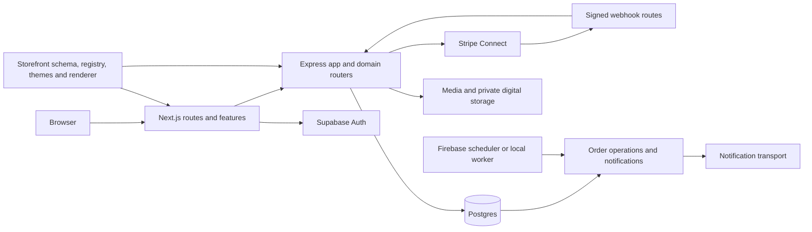

# Jellyshop architecture and restructuring audit

Assessment date: 2026-10-27. This is a working-tree assessment, including uncommitted and untracked files, not a claim about a deployed environment. Paths below are relative to the repository root. No application files have been moved or removed as part of this audit. The existing [file maps](../file-structure/frontend-file-map.md), [function references](../functions/), [endpoint listing](../api/endpoints.md), and [database schema](database-schema.md) are useful indexes, but are snapshots with the limitations below.

## System and boundaries

Jellyshop is a multi-tenant commerce application with merchant administration, an editor and published storefronts, checkout, order management, and payment integration. `jellyshops/` is the Next.js application; `backend/` is an Express API; `jellyshops/packages/` contains shared storefront packages. The backend uses PostgreSQL repositories, Stripe, media storage and optional notification transport. `backend/src/server.ts` runs the standalone API; `backend/src/functions.ts` exports Firebase HTTP and scheduled functions; `firebase.json` builds the backend for deployment.



`backend/src/app.ts` composes middleware and domain routers using `app/dependencies.ts`; Stripe webhook routers are mounted before JSON parsing for signature verification. Merchant routes resolve authentication and store permissions; public routes have separate access rules; internal worker routes use a scheduler secret. `http/errors.ts` handles errors last. Runtime route availability depends on configured dependencies, so a route listing alone does not prove a deployment exposes it.

### Directory responsibilities

```text
jellyshops/
  src/app/             Next.js routes, layouts and route-specific UI
  src/features/        admin, auth, commerce, content, customers, navigation,
                       product-builder, store-editor, storefront, theme-preview
  src/components/      shared UI and application shell
  src/contexts/        application context providers
  src/lib/             cross-feature helpers, domain and demo facilities
  src/test/, e2e/      test setup and browser flows
  packages/            storefront-schema, registry, themes, renderer and UI
  public/, scripts/    static assets and local tooling
backend/
  src/app/             dependency wiring, middleware and router mounts
  src/auth/, tenants/  identity, authorization, store membership and settings
  src/catalog/, media/, taxonomy/  product data, uploads and classification
  src/commerce/, stripe/  checkout, orders, workers and payment integration
  src/storefront/      workspace, compilation, publication and public serving
  src/content/, custom-data/, dynamic-sources/  content and bindings
  src/admin/, customers/, audit/  merchant APIs, customer features and audit
  src/database/, http/ connections, shared HTTP errors and helpers
  sql/, supabase/      migrations and database security assets
  scripts/, test/      operational scripts and integration tests
docs/, scripts/        documentation and repository-level tooling
```

Framework-discovered files, scripts, tests, assets, deployment configuration and package exports are entry points even when no static import points to them. Consult the generated file maps for a per-file inventory, then verify each current file in the tree; they do not cover all of these categories.

### Feature-to-file map

| Task | Frontend | Backend and persistence | Further detail |
| --- | --- | --- | --- |
| Merchant authentication and store access | `src/features/auth/`, admin layout | `backend/src/auth/`, `tenants/`, `app/routes/merchant.ts` | [Authentication](../api/authentication.md) |
| Products, inventory and media | `src/features/product-builder/`, `src/features/admin/catalog-api.ts`, admin product routes | `catalog/`, `media/`, `taxonomy/`; catalog and media migrations | [Products](../features/product-management.md) |
| Checkout and payment | storefront cart and checkout routes; `features/commerce/api/client.ts` | `commerce/routes.ts`, `service.ts`, `checkout-cart.ts`, `payment-intents.ts`, `stripe/`; checkout, inventory and payment tables | [Checkout](../features/checkout.md), [payments](../features/payment-system.md) |
| Orders, fulfilment and notifications | admin order routes; settings notifications page; commerce client | `commerce/merchant-order-routes.ts`, `order-management.ts`, `notifications.ts`, `order-runtime.ts`; order and notification migrations | [Orders](../features/order-management.md), [notifications](../features/notifications-and-digital-delivery.md) |
| Editor, themes and publishing | admin editor route, `features/store-editor/`, storefront packages | `storefront/workspace/`, `compiler/`, `publication/`; workspace and publication tables | [Editor](../features/theme-editor.md), [publishing](../features/publishing.md) |
| Public storefront and content | `src/app/[storeSlug]/`, `features/storefront/`, renderer package | `storefront/`, `content/`, `custom-data/`, `dynamic-sources/` | [Theme system](../features/theme-system.md) |
| Customer accounts and engagement | `features/customers/`, relevant storefront and admin routes | `customers/`, merchant and public customer routers | [Customers](../features/customers.md) |

Frontend paths in the table are under `jellyshops/` unless prefixed `backend/`. Feature guides are starting points, not guaranteed exhaustive descriptions of the current working tree.

### Representative flows and interfaces

1. **Checkout:** `createCommerceApi({ baseUrl, token, fetch })` in `features/commerce/api/client.ts` calls public commerce endpoints. `POST /api/public/stores/:storeId/checkout/attempts` validates cart input and invokes `CheckoutService.begin`; `/payment-intent` invokes `preparePayment(attemptId, storeId)`. The service uses catalog, checkout policy, repository and Stripe gateway dependencies; server-side cart validation and reservation precede payment preparation. Stripe webhook handling updates payment state. Invalid checkout input returns 422; missing configured commerce dependencies produce a 503 fallback. Exact request and response types are in `commerce/routes.ts`, `types.ts`, and client code.
2. **Publish:** editor clients call workspace and publication routes. `CompiledStorefrontPublicationService.publish(storeId, expectedGeneration, idempotencyKey, actorUserId)` compiles a draft, saves a snapshot and activates it through the publication repository; a matching idempotency key can reuse a publication. The public storefront reads the active publication, not a mutable draft. Compiler diagnostics are returned on failure. See `storefront/publication/service.ts` and [publishing](../features/publishing.md).
3. **Notifications and workers:** order-related database migrations and service operations enqueue work. `createOrderRuntime(database, orders, config, env)` composes the optional transport, digital service and settlement hooks; `runWorkers()` processes order operations and notifications and reports health counts. `functions.ts` schedules `orderWorkers` every minute when runtime wiring is available. `backend/scripts/run-notification-worker.ts` uses the separate local loopback worker and secret-protected internal endpoint; it does not run the complete order worker. SMTP and digital storage depend on configuration. Reservation sweeping is a separate concern: inspect `commerce/sweeper.ts` and its deployment scheduling before relying on it.

Important interfaces are defined by source types and route schemas, not by the generated endpoint list alone. Merchant routes generally use bearer authentication plus store-specific permissions; public order links use tokens and rate limiting; Stripe webhooks verify signatures; worker routes use `x-scheduler-secret`. See the route implementations and [API authentication](../api/authentication.md) for exact behavior and errors. The function references index exported signatures but do not fully specify inferred types, side effects, or runtime configuration.

### Automation scope

The inspected source contains order operations, notification queue processing, scheduled workers, webhook processing and a reservation sweeper. Searches for automation and keyword triggers found planning references, not an implemented keyword-trigger automation feature. Do not document creation, keyword matching, actions or execution as an existing system without additional evidence. For a future automation feature, define its product contract and persistence first, then add a feature-owned frontend, authenticated API, service, repository and worker with idempotency and tenant isolation; this is a proposal, not an existing interface.

### Database and integrations

The database is organized around store-scoped tenancy, catalog and media, storefront workspace/publications, content and custom data, checkout/orders, Stripe, customers, and notification/digital delivery. See [database architecture](database-architecture.md) for domain groups and [schema snapshot](database-schema.md) for the database inspected when it was generated. Migration files under both `backend/sql/migrations/` and `backend/supabase/migrations/` must be compared individually; their presence does not prove application to any environment. The current tree includes later product-media and notification-template migrations not listed in the existing schema snapshot. Verify applied versions and relationships against the intended environment before deployment.

## Findings and confidence

| Finding | Evidence and impact | Status |
| --- | --- | --- |
| Existing references are stale | Current untracked `backend/src/commerce/local-notification-worker.ts` is absent from the generated backend file map; current migration filenames are absent from the schema snapshot. | Verified for these examples; full drift not measured. |
| Setup documentation conflicts | `jellyshops/README.md` says Firebase authentication and PostgreSQL are not connected; `backend/README.md`, configuration and dependencies describe actual supported Firebase/Supabase and PostgreSQL integrations. | Verified contradiction; effective environment remains configuration-dependent. |
| Database generator TLS fallback | `scripts/generate-db-docs.mjs` reads `backend/.env` and uses `rejectUnauthorized: false` if no CA file is configured. Its output is a live-environment snapshot, and its table-reference scan matches quoted table names only. | Verified in source; do not execute against a live database until connection security is reviewed. |
| Generated analysis has limited reach | `generate-docs.mjs` scans TS/TSX in selected source directories and resolves relative, `@/`, and selected package imports; it does not establish dynamic, deployment, script or external usage. | Verified; unused exports and circular-import results are leads, not deletion proof. |
| Large mixed-responsibility modules | Existing report identifies the admin editor/order pages, `commerce/repository.ts`, `commerce/order-management.ts`, and `stripe/client.ts`; current order page includes query parsing and several UI components. | Verified candidate for review; size alone does not justify a split. |
| Duplicate names | The existing report flags two `CustomerService` exports and two `createEditorState` exports. Similar names may represent different domains. | Candidate only; compare responsibilities and consumers before consolidation. |
| Historical validation claims | `docs/development/testing.md` contains dated results and the schema snapshot describes one database. Neither proves the current tree or production state. | Verified; use fresh checks and identify their environment. |

No repository-wide manual proof of every unused function, duplication, endpoint contract, database relationship or deployment setting is claimed. Existing generated inventories are broader than this narrative but need regeneration and review to cover the current tree.

## Proposed target and migration

Keep the existing top-level frontend, backend and package boundaries. Under each feature, colocate its UI, client, types and tests; retain Next.js `app/` route files and backend `server.ts`/`functions.ts` as framework and deployment entry points. Keep cross-runtime contracts in an existing appropriate storefront package only when both runtimes actually share them. Avoid a new generic shared package or wholesale moves until ownership and packaging are proven.

| Priority | Current → proposed | Impact and gate |
| --- | --- | --- |
| 1 | Documentation snapshots → refreshed generated references and reviewed narrative | Review generator scope and TLS handling first; compare output with current tree and retain historical/live-schema provenance. No code moves. |
| 2 | `jellyshops/src/app/admin/orders/page.tsx` → retain route; extract `OrderSummary`, `OrderFilters`, `EmptyOrders`, `OrderList`, `OrderRow` into `jellyshops/src/features/commerce/components/order-list/` | Preserve URL parsing, polling, permissions and component props; update route imports. Run order page tests and relevant browser flow. Revert extraction as a single batch if behavior changes. This is a proposed extraction, not a completed move. |
| 3 | `backend/src/commerce/order-management.ts` → retain public service entry; assess extraction of `appendOrderEvent` and `queueShipmentNotification` into `backend/src/commerce/order-events.ts` | First trace every caller and transaction boundary; preserve exported signature and SQL/idempotency semantics. Run order-management, notification and integration tests; revert as one batch. Do not move if tracing shows the boundary is unsuitable. |
| 4 | `jellyshops/src/app/admin/online-store/editor/page.tsx` → retain route; evaluate moving `StoreEditorWorkspace` into `features/store-editor/` | Trace route-specific state, imports and editor tests first; preserve route behavior, preview and publication. Run editor tests and Playwright editor flows. Exact helper splits remain an audit decision, not a required move. |
| 5 | Shared package tarballs and duplicated domain names → no move yet | Inspect package preparation, exports, lockfiles, deploy hooks and all consumers before proposing a mapping. Naming similarity or static no-import output alone is insufficient. |

Each batch needs a fresh import/caller map, a documented compatibility decision and a reviewable rollback. Do not change API paths, exported contracts, migrations, scheduler entry points or deployment configuration as incidental cleanup. For future functionality, add domain behavior to its feature service and repository, expose it through the appropriate router, keep transport validation at the boundary, and colocate tests. Document a feature's routes, persistence and operational dependencies when adding it. Prefer consistent names within each domain and avoid forcing unrelated domains into a generic utilities folder.

## Validation and operations

Run commands from their package directories. Backend: `npm run typecheck`, `npm test`, `npm run test:integration`, `npm run build`, and, after a successful build, `npm run test:start`. Frontend: `npm run typecheck`, `npm run lint`, `npm test`, `npm run build`, and `npm run test:e2e`. Shared package builds run in several pre-scripts. Integration and browser flows may require database, environment configuration, available ports, and Playwright browser binaries; see [testing](../development/testing.md) and the scripts themselves. Never run reset, seed, deployment, or worker commands against an unknown environment merely to establish a baseline.

Baseline on 2026-10-27 in the sandbox: both type checks and the backend build passed. Initial backend unit and integration runs failed before tests executed because Vitest could not rename files in the sandbox temporary directory. With `TEMP` and `TMP` set to the package directory, the local notification worker test passed (4 tests) and the frontend commerce client test passed (10 tests). A broader retry was inconclusive under concurrent resource pressure: the backend pretest and frontend lint ran out of memory, integration tests showed timeouts before the run was interrupted, and the frontend suite was interrupted. The frontend production build failed in Turbopack when its CSS worker process exited before connecting. These observations do not establish the cause of the build failure or a clean full-suite baseline; rerun serially in a suitably provisioned environment. End-to-end tests and built-server smoke tests were not run.

For each future migration, run focused tests first, then relevant wider suites. Include authentication and cross-store isolation; checkout, webhook signatures and idempotency; publication and draft isolation; media persistence; notification retry and worker authorization. Validate a production build and deployment entry points before release, and compare migration versions and secrets in the target environment. See [deployment](../development/deployment.md) and `backend/README.md`; deployment is not performed by this audit.

Maintain this guide alongside behavior changes. Update feature maps and examples with the code, regenerate references only after reviewing generator behavior, and label snapshots with their source and date. Review ownership and dependencies before moving or removing files; keep tests and scripts with their established entry points until their consumers are verified.
