# Database schema

> Generated by `scripts/generate-db-docs.mjs` from the live schema of the database referenced by `backend/.env` (the staging Supabase project) plus a scan of `backend/src`. Do not edit by hand; re-run the script.

60 tables in the `public` schema. Row-level security is enabled on tables marked **RLS**; browser-facing Supabase roles have no direct access to server-owned tables, only the backend runtime role does (see `backend/sql/security` and the isolation migrations).

## Applied migrations (supabase_migrations.schema_migrations)

- `20261020141741` jellyshop_core_mvp_bootstrap
- `20261020155256` backend_runtime_role
- `20261020173712` jelly_signature_customer_services
- `20261020173827` commerce_foreign_key_indexes_and_account_id
- `20261022000000` order_management
- `20261022010000` notifications_digital

Migration SQL lives in `backend/sql/migrations` and `backend/supabase/migrations`.

## Relationship overview

Foreign keys between tables (child → parent):

```mermaid
erDiagram
  Blog ||--o{ Article : has
  CheckoutAttempt ||--o{ InventoryReservation : has
  Collection ||--o{ CollectionProduct : has
  DigitalAsset ||--o{ DigitalEntitlement : has
  DigitalEntitlement ||--o{ DigitalDownloadAttempt : has
  InventoryLevel ||--o{ InventoryReservation : has
  InventoryLevel ||--o{ OrderEditHold : has
  Media ||--o{ ProductMedia : has
  MetafieldDefinition ||--o{ MetafieldValue : has
  MetaobjectDefinition ||--o{ MetaobjectEntry : has
  Order ||--o{ CheckoutAttempt : has
  Order ||--o{ DigitalEntitlement : has
  Order ||--o{ OrderEvent : has
  Order ||--o{ OrderFulfilment : has
  Order ||--o{ OrderItem : has
  Order ||--o{ OrderNote : has
  Order ||--o{ OrderNotification : has
  Order ||--o{ OrderOperation : has
  Order ||--o{ OrderReturn : has
  Order ||--o{ OrderRevision : has
  Order ||--o{ OrderTransaction : has
  Order ||--o{ Payment : has
  OrderRevision ||--o{ OrderEditHold : has
  OrderRevision ||--o{ OrderTransaction : has
  Payment ||--o{ PaymentDispute : has
  Payment ||--o{ Refund : has
  Product ||--o{ CollectionProduct : has
  Product ||--o{ CustomerWishlist : has
  Product ||--o{ DigitalAsset : has
  Product ||--o{ ProductMedia : has
  Product ||--o{ ProductVariant : has
  ProductVariant ||--o{ InventoryLevel : has
  ProductVariant ||--o{ OrderItem : has
  Store ||--o{ Article : has
  Store ||--o{ AuditEvent : has
  Store ||--o{ Blog : has
  Store ||--o{ Collection : has
  Store ||--o{ ContactEnquiry : has
  Store ||--o{ GlobalSection : has
  Store ||--o{ Media : has
  Store ||--o{ MetafieldDefinition : has
  Store ||--o{ MetafieldValue : has
  Store ||--o{ MetaobjectDefinition : has
  Store ||--o{ MetaobjectEntry : has
  Store ||--o{ NavigationMenu : has
  Store ||--o{ NewsletterSubscriber : has
  Store ||--o{ Order : has
  Store ||--o{ Product : has
  Store ||--o{ PublicOrderAccessRateLimit : has
  Store ||--o{ SectionPreset : has
  Store ||--o{ StoreCustomer : has
  Store ||--o{ StoreDomain : has
  Store ||--o{ StoreMembership : has
  Store ||--o{ StoreNotificationBranding : has
  Store ||--o{ StoreOrderCounter : has
  Store ||--o{ StoreOrderManagementSettings : has
  Store ||--o{ StorePage : has
  Store ||--o{ StoreSettings : has
  Store ||--o{ StorefrontDraft : has
  Store ||--o{ StorefrontPublication : has
  Store ||--o{ StorefrontTemplate : has
  Store ||--o{ StorefrontTemplateAssignment : has
  Store ||--o{ StorefrontWorkspace : has
  Store ||--o{ StripeConnectedAccount : has
  Store ||--o{ ThemeConfiguration : has
  StoreCustomer ||--o{ CustomerAddress : has
  StoreCustomer ||--o{ CustomerWishlist : has
  StoreCustomer ||--o{ Order : has
  StorefrontPublication ||--o{ Store : has
  StorefrontTemplate ||--o{ StorefrontTemplateAssignment : has
  StripeConnectedAccount ||--o{ Payment : has
  StripeWebhookEvent ||--o{ WebhookProcessingAttempt : has
  User ||--o{ AuditEvent : has
  User ||--o{ StoreMembership : has
```

## Tables

### `Article` — RLS

| Column | Type | Null | Default |
| --- | --- | --- | --- |
| `id` | text | no |  |
| `storeId` | text | no |  |
| `blogId` | text | no |  |
| `title` | text | no |  |
| `handle` | text | no |  |
| `excerpt` | text | no | `''::text` |
| `content` | jsonb | no |  |
| `featuredMediaId` | text | yes |  |
| `status` | USER-DEFINED | no | `'DRAFT'::"ContentStatus"` |
| `seoTitle` | text | yes |  |
| `seoDescription` | text | yes |  |
| `socialMediaId` | text | yes |  |
| `noindex` | boolean | no | `false` |
| `canonicalOverride` | text | yes |  |
| `publishedAt` | timestamp without time zone | yes |  |
| `createdAt` | timestamp without time zone | no | `CURRENT_TIMESTAMP` |
| `updatedAt` | timestamp without time zone | no |  |

Constraints:

- CHECK: `Article_content_check` — `CHECK ((jsonb_typeof(content) = 'object'::text))`
- FOREIGN KEY: `Article_storeId_blogId_fkey` — `FOREIGN KEY ("storeId", "blogId") REFERENCES "Blog"("storeId", id) ON UPDATE CASCADE ON DELETE RESTRICT`
- FOREIGN KEY: `Article_storeId_fkey` — `FOREIGN KEY ("storeId") REFERENCES "Store"(id) ON UPDATE CASCADE ON DELETE RESTRICT`
- PRIMARY KEY: `Article_pkey` — `PRIMARY KEY (id)`

Indexes:

- `Article_storeId_blogId_handle_key` — `UNIQUE "Article" USING btree ("storeId", "blogId", handle)`
- `Article_storeId_id_key` — `UNIQUE "Article" USING btree ("storeId", id)`
- `Article_storeId_status_idx` — `"Article" USING btree ("storeId", status)`

Referenced by: `backend/src/content/routes.ts`, `backend/src/content/service.ts`, `backend/src/content/sql-repository.ts`, `backend/src/custom-data/sql-repository.ts`, `backend/src/media/storefront-reference-reader.ts`, `backend/src/storefront/context/sql-repository.ts`, `backend/src/storefront/sql-v4-workspace-data-source.ts`, `backend/src/storefront/workspace/sql-repositories.ts`

### `AuditEvent` — RLS

| Column | Type | Null | Default |
| --- | --- | --- | --- |
| `id` | text | no |  |
| `storeId` | text | no |  |
| `actorUserId` | integer | no |  |
| `action` | text | no |  |
| `subjectType` | text | no |  |
| `subjectId` | text | yes |  |
| `metadata` | jsonb | yes |  |
| `createdAt` | timestamp without time zone | no | `CURRENT_TIMESTAMP` |

Constraints:

- FOREIGN KEY: `AuditEvent_actorUserId_fkey` — `FOREIGN KEY ("actorUserId") REFERENCES "User"(id) ON UPDATE CASCADE ON DELETE RESTRICT`
- FOREIGN KEY: `AuditEvent_storeId_fkey` — `FOREIGN KEY ("storeId") REFERENCES "Store"(id) ON UPDATE CASCADE ON DELETE RESTRICT`
- PRIMARY KEY: `AuditEvent_pkey` — `PRIMARY KEY (id)`

Indexes:

- `AuditEvent_actorUserId_createdAt_idx` — `"AuditEvent" USING btree ("actorUserId", "createdAt")`
- `AuditEvent_storeId_createdAt_idx` — `"AuditEvent" USING btree ("storeId", "createdAt")`

Triggers: `AuditEvent_immutable_rows`, `AuditEvent_immutable_truncate`

Referenced by: no backend source file (migration/seed only)

### `Blog` — RLS

| Column | Type | Null | Default |
| --- | --- | --- | --- |
| `id` | text | no |  |
| `storeId` | text | no |  |
| `title` | text | no |  |
| `handle` | text | no |  |
| `createdAt` | timestamp without time zone | no | `CURRENT_TIMESTAMP` |
| `updatedAt` | timestamp without time zone | no |  |

Constraints:

- FOREIGN KEY: `Blog_storeId_fkey` — `FOREIGN KEY ("storeId") REFERENCES "Store"(id) ON UPDATE CASCADE ON DELETE RESTRICT`
- PRIMARY KEY: `Blog_pkey` — `PRIMARY KEY (id)`

Indexes:

- `Blog_storeId_handle_key` — `UNIQUE "Blog" USING btree ("storeId", handle)`
- `Blog_storeId_id_key` — `UNIQUE "Blog" USING btree ("storeId", id)`

Referenced by: `backend/src/content/routes.ts`, `backend/src/content/service.ts`, `backend/src/content/sql-repository.ts`, `backend/src/custom-data/sql-repository.ts`, `backend/src/storefront/context/sql-repository.ts`, `backend/src/storefront/sql-v4-workspace-data-source.ts`, `backend/src/storefront/workspace/sql-repositories.ts`

### `CheckoutAttempt` — RLS

| Column | Type | Null | Default |
| --- | --- | --- | --- |
| `id` | text | no |  |
| `orderId` | text | no |  |
| `storeId` | text | no |  |
| `cartKey` | text | no |  |
| `cartHash` | text | no |  |
| `stripeIdempotencyKey` | text | no |  |
| `paymentIntentId` | text | yes |  |
| `status` | text | no | `'PAYMENT_INTENT_CREATING'::text` |
| `expiresAt` | timestamp with time zone | no |  |
| `createdAt` | timestamp with time zone | no | `CURRENT_TIMESTAMP` |

Constraints:

- CHECK: `CheckoutAttempt_status_check` — `CHECK ((status = ANY (ARRAY['PAYMENT_INTENT_CREATING'::text, 'READY'::text, 'PROCESSING'::text, 'SUCCEEDED'::text, 'CANCELLED'::text, 'EXPIRED'::text, 'FAILED'::text])))`
- FOREIGN KEY: `CheckoutAttempt_storeId_orderId_fkey` — `FOREIGN KEY ("storeId", "orderId") REFERENCES "Order"("storeId", id) ON DELETE RESTRICT`
- PRIMARY KEY: `CheckoutAttempt_pkey` — `PRIMARY KEY (id)`
- UNIQUE: `CheckoutAttempt_orderId_key` — `UNIQUE ("orderId")`
- UNIQUE: `CheckoutAttempt_paymentIntentId_key` — `UNIQUE ("paymentIntentId")`
- UNIQUE: `CheckoutAttempt_storeId_id_key` — `UNIQUE ("storeId", id)`
- UNIQUE: `CheckoutAttempt_stripeIdempotencyKey_key` — `UNIQUE ("stripeIdempotencyKey")`

Indexes:

- `CheckoutAttempt_status_expiresAt_idx` — `"CheckoutAttempt" USING btree (status, "expiresAt")`
- `CheckoutAttempt_storeId_cartKey_idx` — `"CheckoutAttempt" USING btree ("storeId", "cartKey")`
- `CheckoutAttempt_storeId_orderId_idx` — `"CheckoutAttempt" USING btree ("storeId", "orderId")`

Referenced by: `backend/src/commerce/order-management.ts`, `backend/src/commerce/payment-intents.ts`, `backend/src/commerce/repository.ts`, `backend/src/commerce/service.ts`, `backend/src/commerce/sweeper.ts`, `backend/src/stripe/webhooks/processor.ts`

### `Collection` — RLS

| Column | Type | Null | Default |
| --- | --- | --- | --- |
| `id` | text | no |  |
| `storeId` | text | no |  |
| `title` | text | no |  |
| `slug` | text | no |  |
| `description` | text | no | `''::text` |
| `externalId` | text | yes |  |
| `createdAt` | timestamp without time zone | no | `CURRENT_TIMESTAMP` |
| `updatedAt` | timestamp without time zone | no |  |

Constraints:

- FOREIGN KEY: `Collection_storeId_fkey` — `FOREIGN KEY ("storeId") REFERENCES "Store"(id) ON UPDATE CASCADE ON DELETE RESTRICT`
- PRIMARY KEY: `Collection_pkey` — `PRIMARY KEY (id)`

Indexes:

- `Collection_storeId_externalId_key` — `UNIQUE "Collection" USING btree ("storeId", "externalId")`
- `Collection_storeId_id_key` — `UNIQUE "Collection" USING btree ("storeId", id)`
- `Collection_storeId_slug_key` — `UNIQUE "Collection" USING btree ("storeId", slug)`

Referenced by: `backend/src/catalog/postgres-repository.ts`, `backend/src/custom-data/sql-repository.ts`, `backend/src/storefront/sql-v4-workspace-data-source.ts`, `backend/src/storefront/workspace/sql-repositories.ts`

### `CollectionProduct` — RLS

| Column | Type | Null | Default |
| --- | --- | --- | --- |
| `storeId` | text | no |  |
| `collectionId` | text | no |  |
| `productId` | text | no |  |
| `position` | integer | no | `0` |

Constraints:

- CHECK: `CollectionProduct_position_check` — `CHECK (("position" >= 0))`
- FOREIGN KEY: `CollectionProduct_storeId_collectionId_fkey` — `FOREIGN KEY ("storeId", "collectionId") REFERENCES "Collection"("storeId", id) ON UPDATE CASCADE ON DELETE RESTRICT`
- FOREIGN KEY: `CollectionProduct_storeId_productId_fkey` — `FOREIGN KEY ("storeId", "productId") REFERENCES "Product"("storeId", id) ON UPDATE CASCADE ON DELETE RESTRICT`
- PRIMARY KEY: `CollectionProduct_pkey` — `PRIMARY KEY ("storeId", "collectionId", "productId")`

Indexes:

- `CollectionProduct_storeId_productId_idx` — `"CollectionProduct" USING btree ("storeId", "productId")`

Referenced by: no backend source file (migration/seed only)

### `ContactEnquiry` — RLS

| Column | Type | Null | Default |
| --- | --- | --- | --- |
| `id` | text | no |  |
| `storeId` | text | no |  |
| `name` | text | no |  |
| `email` | text | no |  |
| `message` | text | no |  |
| `status` | text | no | `'NEW'::text` |
| `revision` | integer | no | `0` |
| `createdAt` | timestamp with time zone | no | `now()` |
| `updatedAt` | timestamp with time zone | no | `now()` |

Constraints:

- CHECK: `ContactEnquiry_revision_check` — `CHECK ((revision >= 0))`
- CHECK: `ContactEnquiry_status_check` — `CHECK ((status = ANY (ARRAY['NEW'::text, 'READ'::text, 'CLOSED'::text])))`
- FOREIGN KEY: `ContactEnquiry_storeId_fkey` — `FOREIGN KEY ("storeId") REFERENCES "Store"(id)`
- PRIMARY KEY: `ContactEnquiry_pkey` — `PRIMARY KEY (id)`

Indexes:

- `ContactEnquiry_store_idx` — `"ContactEnquiry" USING btree ("storeId", "createdAt" DESC, id)`

Referenced by: `backend/src/customers/service.ts`

### `CustomerAddress` — RLS

| Column | Type | Null | Default |
| --- | --- | --- | --- |
| `id` | text | no |  |
| `storeId` | text | no |  |
| `customerId` | text | no |  |
| `label` | text | no | `''::text` |
| `name` | text | no |  |
| `line1` | text | no |  |
| `line2` | text | no | `''::text` |
| `city` | text | no |  |
| `region` | text | no | `''::text` |
| `postalCode` | text | no |  |
| `country` | character varying(2) | no |  |
| `phone` | text | no | `''::text` |
| `revision` | integer | no | `0` |
| `createdAt` | timestamp with time zone | no | `now()` |
| `updatedAt` | timestamp with time zone | no | `now()` |

Constraints:

- CHECK: `CustomerAddress_revision_check` — `CHECK ((revision >= 0))`
- FOREIGN KEY: `CustomerAddress_storeId_customerId_fkey` — `FOREIGN KEY ("storeId", "customerId") REFERENCES "StoreCustomer"("storeId", id)`
- PRIMARY KEY: `CustomerAddress_pkey` — `PRIMARY KEY (id)`

Indexes:

- `CustomerAddress_owner_idx` — `"CustomerAddress" USING btree ("storeId", "customerId")`

Referenced by: `backend/src/customers/service.ts`

### `CustomerWishlist` — RLS

| Column | Type | Null | Default |
| --- | --- | --- | --- |
| `storeId` | text | no |  |
| `customerId` | text | no |  |
| `productId` | text | no |  |
| `createdAt` | timestamp with time zone | no | `now()` |

Constraints:

- FOREIGN KEY: `CustomerWishlist_storeId_customerId_fkey` — `FOREIGN KEY ("storeId", "customerId") REFERENCES "StoreCustomer"("storeId", id)`
- FOREIGN KEY: `CustomerWishlist_storeId_productId_fkey` — `FOREIGN KEY ("storeId", "productId") REFERENCES "Product"("storeId", id)`
- PRIMARY KEY: `CustomerWishlist_pkey` — `PRIMARY KEY ("storeId", "customerId", "productId")`

Indexes:

- `CustomerWishlist_product_idx` — `"CustomerWishlist" USING btree ("storeId", "productId")`

Referenced by: `backend/src/customers/service.ts`

### `DigitalAsset` — RLS

| Column | Type | Null | Default |
| --- | --- | --- | --- |
| `id` | text | no |  |
| `storeId` | text | no |  |
| `productId` | text | no |  |
| `storageKey` | text | no |  |
| `filename` | text | no |  |
| `mimeType` | text | no |  |
| `sizeBytes` | bigint | no |  |
| `maxDownloads` | integer | yes |  |
| `expiresAfterDays` | integer | yes |  |
| `archivedAt` | timestamp with time zone | yes |  |
| `createdAt` | timestamp with time zone | no | `CURRENT_TIMESTAMP` |

Constraints:

- CHECK: `DigitalAsset_expiresAfterDays_check` — `CHECK (("expiresAfterDays" > 0))`
- CHECK: `DigitalAsset_maxDownloads_check` — `CHECK (("maxDownloads" > 0))`
- CHECK: `DigitalAsset_sizeBytes_check` — `CHECK (("sizeBytes" > 0))`
- FOREIGN KEY: `DigitalAsset_storeId_productId_fkey` — `FOREIGN KEY ("storeId", "productId") REFERENCES "Product"("storeId", id)`
- PRIMARY KEY: `DigitalAsset_pkey` — `PRIMARY KEY (id)`
- UNIQUE: `DigitalAsset_storageKey_key` — `UNIQUE ("storageKey")`
- UNIQUE: `DigitalAsset_storeId_id_key` — `UNIQUE ("storeId", id)`

Referenced by: `backend/src/commerce/digital.ts`, `backend/src/commerce/notifications.ts`, `backend/src/commerce/order-management.ts`, `backend/src/commerce/service.ts`

### `DigitalDownloadAttempt` — RLS

| Column | Type | Null | Default |
| --- | --- | --- | --- |
| `id` | text | no |  |
| `entitlementId` | text | no |  |
| `createdAt` | timestamp with time zone | no | `CURRENT_TIMESTAMP` |

Constraints:

- FOREIGN KEY: `DigitalDownloadAttempt_entitlementId_fkey` — `FOREIGN KEY ("entitlementId") REFERENCES "DigitalEntitlement"(id)`
- PRIMARY KEY: `DigitalDownloadAttempt_pkey` — `PRIMARY KEY (id)`

Referenced by: `backend/src/commerce/digital.ts`

### `DigitalEntitlement` — RLS

| Column | Type | Null | Default |
| --- | --- | --- | --- |
| `id` | text | no |  |
| `storeId` | text | no |  |
| `orderId` | text | no |  |
| `variantId` | text | no |  |
| `assetId` | text | no |  |
| `tokenHash` | text | yes |  |
| `maxDownloads` | integer | yes |  |
| `downloadCount` | integer | no | `0` |
| `expiresAt` | timestamp with time zone | yes |  |
| `revokedAt` | timestamp with time zone | yes |  |
| `createdAt` | timestamp with time zone | no | `CURRENT_TIMESTAMP` |

Constraints:

- CHECK: `DigitalEntitlement_downloadCount_check` — `CHECK (("downloadCount" >= 0))`
- FOREIGN KEY: `DigitalEntitlement_storeId_assetId_fkey` — `FOREIGN KEY ("storeId", "assetId") REFERENCES "DigitalAsset"("storeId", id)`
- FOREIGN KEY: `DigitalEntitlement_storeId_orderId_fkey` — `FOREIGN KEY ("storeId", "orderId") REFERENCES "Order"("storeId", id)`
- PRIMARY KEY: `DigitalEntitlement_pkey` — `PRIMARY KEY (id)`
- UNIQUE: `DigitalEntitlement_storeId_orderId_variantId_assetId_key` — `UNIQUE ("storeId", "orderId", "variantId", "assetId")`

Referenced by: `backend/src/commerce/digital.ts`, `backend/src/commerce/notifications.ts`, `backend/src/commerce/order-management.ts`

### `GlobalSection` — RLS

| Column | Type | Null | Default |
| --- | --- | --- | --- |
| `id` | text | no |  |
| `storeId` | text | no |  |
| `revision` | integer | no | `0` |
| `name` | text | no |  |
| `section` | jsonb | no |  |
| `createdAt` | timestamp without time zone | no | `CURRENT_TIMESTAMP` |
| `updatedAt` | timestamp without time zone | no |  |

Constraints:

- CHECK: `GlobalSection_revision_check` — `CHECK ((revision >= 0))`
- CHECK: `GlobalSection_section_check` — `CHECK ((jsonb_typeof(section) = 'object'::text))`
- FOREIGN KEY: `GlobalSection_storeId_fkey` — `FOREIGN KEY ("storeId") REFERENCES "Store"(id) ON UPDATE CASCADE ON DELETE RESTRICT`
- PRIMARY KEY: `GlobalSection_pkey` — `PRIMARY KEY (id)`

Indexes:

- `GlobalSection_storeId_id_key` — `UNIQUE "GlobalSection" USING btree ("storeId", id)`
- `GlobalSection_storeId_name_idx` — `"GlobalSection" USING btree ("storeId", name)`

Referenced by: `backend/src/app.ts`, `backend/src/media/storefront-reference-reader.ts`, `backend/src/storefront/sql-v4-workspace-data-source.ts`, `backend/src/storefront/starter/installation-service.ts`, `backend/src/storefront/workspace/sql-global-section-store.ts`, `backend/src/storefront/workspace/sql-repositories.ts`

### `InventoryLevel` — RLS

| Column | Type | Null | Default |
| --- | --- | --- | --- |
| `storeId` | text | no |  |
| `variantId` | text | no |  |
| `quantity` | integer | no | `0` |
| `reserved` | integer | no | `0` |
| `updatedAt` | timestamp without time zone | no |  |

Constraints:

- CHECK: `InventoryLevel_quantity_check` — `CHECK ((quantity >= 0))`
- CHECK: `InventoryLevel_reserved_check` — `CHECK (((reserved >= 0) AND (reserved <= quantity)))`
- FOREIGN KEY: `InventoryLevel_storeId_variantId_fkey` — `FOREIGN KEY ("storeId", "variantId") REFERENCES "ProductVariant"("storeId", id) ON UPDATE CASCADE ON DELETE RESTRICT`
- PRIMARY KEY: `InventoryLevel_pkey` — `PRIMARY KEY ("storeId", "variantId")`

Referenced by: `backend/src/admin/service.ts`, `backend/src/catalog/postgres-repository.ts`, `backend/src/commerce/order-management.ts`, `backend/src/commerce/repository.ts`, `backend/src/stripe/webhooks/processor.ts`

### `InventoryReservation` — RLS

| Column | Type | Null | Default |
| --- | --- | --- | --- |
| `attemptId` | text | no |  |
| `storeId` | text | no |  |
| `variantId` | text | no |  |
| `quantity` | integer | no |  |
| `status` | text | no | `'HELD'::text` |
| `expiresAt` | timestamp with time zone | no |  |

Constraints:

- CHECK: `InventoryReservation_quantity_check` — `CHECK ((quantity > 0))`
- CHECK: `InventoryReservation_status_check` — `CHECK ((status = ANY (ARRAY['HELD'::text, 'RELEASED'::text, 'SOLD'::text])))`
- FOREIGN KEY: `InventoryReservation_storeId_attemptId_fkey` — `FOREIGN KEY ("storeId", "attemptId") REFERENCES "CheckoutAttempt"("storeId", id) ON DELETE RESTRICT`
- FOREIGN KEY: `InventoryReservation_storeId_variantId_fkey` — `FOREIGN KEY ("storeId", "variantId") REFERENCES "InventoryLevel"("storeId", "variantId") ON DELETE RESTRICT`
- PRIMARY KEY: `InventoryReservation_pkey` — `PRIMARY KEY ("attemptId", "variantId")`

Indexes:

- `InventoryReservation_status_expiresAt_idx` — `"InventoryReservation" USING btree (status, "expiresAt")`
- `InventoryReservation_storeId_attemptId_idx` — `"InventoryReservation" USING btree ("storeId", "attemptId")`
- `InventoryReservation_storeId_variantId_idx` — `"InventoryReservation" USING btree ("storeId", "variantId")`

Referenced by: `backend/src/commerce/order-management.ts`, `backend/src/commerce/repository.ts`, `backend/src/stripe/webhooks/processor.ts`

### `Media` — RLS

| Column | Type | Null | Default |
| --- | --- | --- | --- |
| `id` | text | no |  |
| `storeId` | text | no |  |
| `type` | text | no |  |
| `storageKey` | text | no |  |
| `url` | text | no |  |
| `mimeType` | text | no |  |
| `byteSize` | integer | no |  |
| `width` | integer | yes |  |
| `height` | integer | yes |  |
| `originalName` | text | no |  |
| `altText` | text | yes |  |
| `referenced` | boolean | no | `false` |
| `createdAt` | timestamp without time zone | no | `CURRENT_TIMESTAMP` |

Constraints:

- CHECK: `Media_byteSize_check` — `CHECK (("byteSize" >= 0))`
- CHECK: `Media_height_check` — `CHECK (((height IS NULL) OR (height > 0)))`
- CHECK: `Media_type_check` — `CHECK ((type = ANY (ARRAY['image'::text, 'file'::text])))`
- CHECK: `Media_width_check` — `CHECK (((width IS NULL) OR (width > 0)))`
- FOREIGN KEY: `Media_storeId_fkey` — `FOREIGN KEY ("storeId") REFERENCES "Store"(id) ON UPDATE CASCADE ON DELETE RESTRICT`
- PRIMARY KEY: `Media_pkey` — `PRIMARY KEY (id)`

Indexes:

- `Media_storeId_createdAt_idx` — `"Media" USING btree ("storeId", "createdAt")`
- `Media_storeId_id_key` — `UNIQUE "Media" USING btree ("storeId", id)`
- `Media_storeId_storageKey_key` — `UNIQUE "Media" USING btree ("storeId", "storageKey")`

Referenced by: `backend/src/catalog/postgres-repository.ts`, `backend/src/commerce/order-management.ts`, `backend/src/media/sql-media-repository.ts`

### `MetafieldDefinition` — RLS

| Column | Type | Null | Default |
| --- | --- | --- | --- |
| `id` | text | no |  |
| `storeId` | text | no |  |
| `ownerType` | text | no |  |
| `namespace` | text | no |  |
| `key` | text | no |  |
| `name` | text | no |  |
| `description` | text | yes |  |
| `type` | text | no |  |
| `validations` | jsonb | yes |  |
| `storefrontVisible` | boolean | no | `false` |
| `origin` | text | no | `'jelly'::text` |
| `archivedAt` | timestamp without time zone | yes |  |
| `createdAt` | timestamp without time zone | no | `CURRENT_TIMESTAMP` |
| `updatedAt` | timestamp without time zone | no |  |

Constraints:

- CHECK: `MetafieldDefinition_key_check` — `CHECK ((key ~ '^[a-z][a-z0-9_]*$'::text))`
- CHECK: `MetafieldDefinition_namespace_check` — `CHECK ((namespace ~ '^[a-z][a-z0-9_]*$'::text))`
- CHECK: `MetafieldDefinition_origin_check` — `CHECK ((origin = ANY (ARRAY['jelly'::text, 'provider'::text])))`
- CHECK: `MetafieldDefinition_ownerType_check` — `CHECK (("ownerType" = ANY (ARRAY['store'::text, 'product'::text, 'variant'::text, 'collection'::text, 'page'::text, 'blog'::text, 'article'::text])))`
- FOREIGN KEY: `MetafieldDefinition_storeId_fkey` — `FOREIGN KEY ("storeId") REFERENCES "Store"(id) ON UPDATE CASCADE ON DELETE RESTRICT`
- PRIMARY KEY: `MetafieldDefinition_pkey` — `PRIMARY KEY (id)`

Indexes:

- `MetafieldDefinition_storeId_id_key` — `UNIQUE "MetafieldDefinition" USING btree ("storeId", id)`
- `MetafieldDefinition_storeId_ownerType_archivedAt_idx` — `"MetafieldDefinition" USING btree ("storeId", "ownerType", "archivedAt")`
- `MetafieldDefinition_storeId_ownerType_namespace_key_key` — `UNIQUE "MetafieldDefinition" USING btree ("storeId", "ownerType", namespace, key)`

Referenced by: `backend/src/custom-data/sql-repository.ts`

### `MetafieldValue` — RLS

| Column | Type | Null | Default |
| --- | --- | --- | --- |
| `id` | text | no |  |
| `storeId` | text | no |  |
| `definitionId` | text | no |  |
| `ownerId` | text | no |  |
| `value` | jsonb | no |  |
| `updatedAt` | timestamp without time zone | no |  |

Constraints:

- FOREIGN KEY: `MetafieldValue_storeId_definitionId_fkey` — `FOREIGN KEY ("storeId", "definitionId") REFERENCES "MetafieldDefinition"("storeId", id) ON UPDATE CASCADE ON DELETE RESTRICT`
- FOREIGN KEY: `MetafieldValue_storeId_fkey` — `FOREIGN KEY ("storeId") REFERENCES "Store"(id) ON UPDATE CASCADE ON DELETE RESTRICT`
- PRIMARY KEY: `MetafieldValue_pkey` — `PRIMARY KEY (id)`

Indexes:

- `MetafieldValue_storeId_definitionId_ownerId_key` — `UNIQUE "MetafieldValue" USING btree ("storeId", "definitionId", "ownerId")`
- `MetafieldValue_storeId_ownerId_idx` — `"MetafieldValue" USING btree ("storeId", "ownerId")`

Referenced by: `backend/src/custom-data/sql-repository.ts`

### `MetaobjectDefinition` — RLS

| Column | Type | Null | Default |
| --- | --- | --- | --- |
| `id` | text | no |  |
| `storeId` | text | no |  |
| `handle` | text | no |  |
| `name` | text | no |  |
| `storefrontVisible` | boolean | no | `false` |
| `fields` | jsonb | no |  |
| `archivedAt` | timestamp without time zone | yes |  |
| `createdAt` | timestamp without time zone | no | `CURRENT_TIMESTAMP` |
| `updatedAt` | timestamp without time zone | no |  |

Constraints:

- CHECK: `MetaobjectDefinition_fields_check` — `CHECK ((jsonb_typeof(fields) = 'array'::text))`
- CHECK: `MetaobjectDefinition_handle_check` — `CHECK ((handle ~ '^[a-z][a-z0-9_]*$'::text))`
- FOREIGN KEY: `MetaobjectDefinition_storeId_fkey` — `FOREIGN KEY ("storeId") REFERENCES "Store"(id) ON UPDATE CASCADE ON DELETE RESTRICT`
- PRIMARY KEY: `MetaobjectDefinition_pkey` — `PRIMARY KEY (id)`

Indexes:

- `MetaobjectDefinition_storeId_archivedAt_idx` — `"MetaobjectDefinition" USING btree ("storeId", "archivedAt")`
- `MetaobjectDefinition_storeId_handle_key` — `UNIQUE "MetaobjectDefinition" USING btree ("storeId", handle)`
- `MetaobjectDefinition_storeId_id_key` — `UNIQUE "MetaobjectDefinition" USING btree ("storeId", id)`

Referenced by: `backend/src/custom-data/sql-repository.ts`

### `MetaobjectEntry` — RLS

| Column | Type | Null | Default |
| --- | --- | --- | --- |
| `id` | text | no |  |
| `storeId` | text | no |  |
| `definitionId` | text | no |  |
| `handle` | text | no |  |
| `displayName` | text | no |  |
| `values` | jsonb | no |  |
| `archivedAt` | timestamp without time zone | yes |  |
| `createdAt` | timestamp without time zone | no | `CURRENT_TIMESTAMP` |
| `updatedAt` | timestamp without time zone | no |  |

Constraints:

- CHECK: `MetaobjectEntry_handle_check` — `CHECK ((handle ~ '^[a-z][a-z0-9-]*$'::text))`
- CHECK: `MetaobjectEntry_values_check` — `CHECK ((jsonb_typeof("values") = 'object'::text))`
- FOREIGN KEY: `MetaobjectEntry_storeId_definitionId_fkey` — `FOREIGN KEY ("storeId", "definitionId") REFERENCES "MetaobjectDefinition"("storeId", id) ON UPDATE CASCADE ON DELETE RESTRICT`
- FOREIGN KEY: `MetaobjectEntry_storeId_fkey` — `FOREIGN KEY ("storeId") REFERENCES "Store"(id) ON UPDATE CASCADE ON DELETE RESTRICT`
- PRIMARY KEY: `MetaobjectEntry_pkey` — `PRIMARY KEY (id)`

Indexes:

- `MetaobjectEntry_storeId_definitionId_archivedAt_idx` — `"MetaobjectEntry" USING btree ("storeId", "definitionId", "archivedAt")`
- `MetaobjectEntry_storeId_definitionId_handle_key` — `UNIQUE "MetaobjectEntry" USING btree ("storeId", "definitionId", handle)`
- `MetaobjectEntry_storeId_id_key` — `UNIQUE "MetaobjectEntry" USING btree ("storeId", id)`

Referenced by: `backend/src/custom-data/sql-repository.ts`

### `NavigationMenu` — RLS

| Column | Type | Null | Default |
| --- | --- | --- | --- |
| `id` | text | no |  |
| `storeId` | text | no |  |
| `revision` | integer | no | `0` |
| `name` | text | no |  |
| `handle` | text | no |  |
| `items` | jsonb | no |  |
| `createdAt` | timestamp without time zone | no | `CURRENT_TIMESTAMP` |
| `updatedAt` | timestamp without time zone | no |  |

Constraints:

- CHECK: `NavigationMenu_items_check` — `CHECK ((jsonb_typeof(items) = 'array'::text))`
- CHECK: `NavigationMenu_revision_check` — `CHECK ((revision >= 0))`
- FOREIGN KEY: `NavigationMenu_storeId_fkey` — `FOREIGN KEY ("storeId") REFERENCES "Store"(id) ON UPDATE CASCADE ON DELETE RESTRICT`
- PRIMARY KEY: `NavigationMenu_pkey` — `PRIMARY KEY (id)`

Indexes:

- `NavigationMenu_storeId_handle_key` — `UNIQUE "NavigationMenu" USING btree ("storeId", handle)`
- `NavigationMenu_storeId_id_key` — `UNIQUE "NavigationMenu" USING btree ("storeId", id)`

Referenced by: `backend/src/storefront/sql-v4-workspace-data-source.ts`, `backend/src/storefront/starter/installation-service.ts`, `backend/src/storefront/workspace/sql-repositories.ts`

### `NewsletterSubscriber` — RLS

| Column | Type | Null | Default |
| --- | --- | --- | --- |
| `id` | text | no |  |
| `storeId` | text | no |  |
| `email` | text | no |  |
| `consentAt` | timestamp with time zone | no | `now()` |
| `source` | text | no |  |
| `unsubscribedAt` | timestamp with time zone | yes |  |

Constraints:

- FOREIGN KEY: `NewsletterSubscriber_storeId_fkey` — `FOREIGN KEY ("storeId") REFERENCES "Store"(id)`
- PRIMARY KEY: `NewsletterSubscriber_pkey` — `PRIMARY KEY (id)`
- UNIQUE: `NewsletterSubscriber_storeId_email_key` — `UNIQUE ("storeId", email)`
- UNIQUE: `NewsletterSubscriber_storeId_id_key` — `UNIQUE ("storeId", id)`

Referenced by: `backend/src/customers/service.ts`

### `Order` — RLS

| Column | Type | Null | Default |
| --- | --- | --- | --- |
| `id` | text | no |  |
| `storeId` | text | no |  |
| `number` | text | no |  |
| `publicToken` | text | no |  |
| `status` | text | no | `'PENDING_PAYMENT'::text` |
| `fulfilmentStartedAt` | timestamp with time zone | yes |  |
| `customerSnapshot` | jsonb | no |  |
| `subtotalMinor` | integer | no |  |
| `shippingMinor` | integer | no |  |
| `totalMinor` | integer | no |  |
| `currency` | text | no |  |
| `createdAt` | timestamp with time zone | no | `CURRENT_TIMESTAMP` |
| `updatedAt` | timestamp with time zone | no | `CURRENT_TIMESTAMP` |
| `customerId` | text | yes |  |
| `revision` | integer | no | `1` |
| `taxMinor` | integer | yes |  |
| `discountMinor` | integer | yes |  |
| `deliverySnapshot` | jsonb | yes |  |
| `billingAddress` | jsonb | yes |  |
| `customerNote` | text | yes |  |
| `isTest` | boolean | no | `false` |
| `balanceDueMinor` | integer | no | `0` |
| `lifecycle` | text | no | `'OPEN'::text` |
| `fulfilmentStatus` | text | no | `'UNFULFILLED'::text` |

Constraints:

- CHECK: `Order_balanceDueMinor_check` — `CHECK (("balanceDueMinor" >= 0))`
- CHECK: `Order_currency_check` — `CHECK ((currency ~ '^[A-Z]{3}$'::text))`
- CHECK: `Order_discountMinor_check` — `CHECK (("discountMinor" >= 0))`
- CHECK: `Order_revision_check` — `CHECK ((revision > 0))`
- CHECK: `Order_shippingMinor_check` — `CHECK (("shippingMinor" >= 0))`
- CHECK: `Order_status_check` — `CHECK ((status = ANY (ARRAY['PENDING_PAYMENT'::text, 'PAID'::text, 'PENDING'::text, 'CONFIRMED'::text, 'PROCESSING'::text, 'SHIPPED'::text, 'DELIVERED'::text, 'CANCELLED'::text, 'REFUNDED'::text])))`
- CHECK: `Order_taxMinor_check` — `CHECK (("taxMinor" >= 0))`
- CHECK: `Order_totalMinor_check` — `CHECK (("totalMinor" >= 0))`
- CHECK: `Order_total_breakdown_check` — `CHECK ((("totalMinor")::bigint = (((("subtotalMinor")::bigint + ("shippingMinor")::bigint) + (COALESCE("taxMinor", 0))::bigint) - (COALESCE("discountMinor", 0))::bigint)))`
- FOREIGN KEY: `Order_customer_fkey` — `FOREIGN KEY ("storeId", "customerId") REFERENCES "StoreCustomer"("storeId", id)`
- FOREIGN KEY: `Order_storeId_fkey` — `FOREIGN KEY ("storeId") REFERENCES "Store"(id) ON DELETE RESTRICT`
- PRIMARY KEY: `Order_pkey` — `PRIMARY KEY (id)`
- t: `jelly_capture_original_order_revision` — `TRIGGER DEFERRABLE INITIALLY DEFERRED`
- UNIQUE: `Order_publicToken_key` — `UNIQUE ("publicToken")`
- UNIQUE: `Order_storeId_id_key` — `UNIQUE ("storeId", id)`
- UNIQUE: `Order_storeId_number_key` — `UNIQUE ("storeId", number)`

Indexes:

- `Order_customer_idx` — `"Order" USING btree ("storeId", "customerId", "createdAt" DESC, id)`
- `Order_storeId_createdAt_idx` — `"Order" USING btree ("storeId", "createdAt")`
- `Order_storeId_status_idx` — `"Order" USING btree ("storeId", status)`

Triggers: `jelly_capture_original_order_revision`, `jelly_order_notification_trigger`

Referenced by: `backend/src/admin/service.ts`, `backend/src/catalog/postgres-repository.ts`, `backend/src/commerce/digital.ts`, `backend/src/commerce/fulfilment.ts`, `backend/src/commerce/merchant-orders.ts`, `backend/src/commerce/notifications.ts`, `backend/src/commerce/order-management.ts`, `backend/src/commerce/payment-intents.ts`, `backend/src/commerce/refunds.ts`, `backend/src/commerce/repository.ts`, `backend/src/commerce/service.ts`, `backend/src/commerce/sweeper.ts`, `backend/src/customers/service.ts`, `backend/src/stripe/webhooks/processor.ts`, `backend/src/tenants/settings.ts`

### `OrderEditHold` — RLS

| Column | Type | Null | Default |
| --- | --- | --- | --- |
| `revisionId` | text | no |  |
| `storeId` | text | no |  |
| `variantId` | text | no |  |
| `quantity` | integer | no |  |
| `released` | boolean | no | `false` |

Constraints:

- CHECK: `OrderEditHold_quantity_check` — `CHECK ((quantity > 0))`
- FOREIGN KEY: `OrderEditHold_revisionId_fkey` — `FOREIGN KEY ("revisionId") REFERENCES "OrderRevision"(id)`
- FOREIGN KEY: `OrderEditHold_revision_store_fk` — `FOREIGN KEY ("storeId", "revisionId") REFERENCES "OrderRevision"("storeId", id)`
- FOREIGN KEY: `OrderEditHold_storeId_variantId_fkey` — `FOREIGN KEY ("storeId", "variantId") REFERENCES "InventoryLevel"("storeId", "variantId")`
- PRIMARY KEY: `OrderEditHold_pkey` — `PRIMARY KEY ("revisionId", "variantId")`

Referenced by: `backend/src/commerce/order-management.ts`

### `OrderEvent` — RLS

| Column | Type | Null | Default |
| --- | --- | --- | --- |
| `id` | text | no |  |
| `storeId` | text | no |  |
| `orderId` | text | no |  |
| `type` | text | no |  |
| `actorId` | text | yes |  |
| `details` | jsonb | no | `'{}'::jsonb` |
| `createdAt` | timestamp with time zone | no | `now()` |

Constraints:

- FOREIGN KEY: `OrderEvent_storeId_orderId_fkey` — `FOREIGN KEY ("storeId", "orderId") REFERENCES "Order"("storeId", id)`
- PRIMARY KEY: `OrderEvent_pkey` — `PRIMARY KEY (id)`

Indexes:

- `OrderEvent_storeId_orderId_createdAt_idx` — `"OrderEvent" USING btree ("storeId", "orderId", "createdAt")`

Triggers: `jelly_financial_event_notification_trigger`

Referenced by: `backend/src/commerce/notifications.ts`, `backend/src/commerce/order-management.ts`

### `OrderFulfilment` — RLS

| Column | Type | Null | Default |
| --- | --- | --- | --- |
| `id` | text | no |  |
| `storeId` | text | no |  |
| `orderId` | text | no |  |
| `items` | jsonb | no |  |
| `status` | text | no | `'SHIPPED'::text` |
| `trackingNumber` | text | yes |  |
| `carrier` | text | yes |  |
| `trackingUrl` | text | yes |  |
| `createdAt` | timestamp with time zone | no | `now()` |
| `deliveredAt` | timestamp with time zone | yes |  |

Constraints:

- CHECK: `OrderFulfilment_status_check` — `CHECK ((status = ANY (ARRAY['SHIPPED'::text, 'DELIVERED'::text])))`
- FOREIGN KEY: `OrderFulfilment_storeId_orderId_fkey` — `FOREIGN KEY ("storeId", "orderId") REFERENCES "Order"("storeId", id)`
- PRIMARY KEY: `OrderFulfilment_pkey` — `PRIMARY KEY (id)`

Referenced by: `backend/src/commerce/fulfilment.ts`, `backend/src/commerce/notifications.ts`, `backend/src/commerce/order-management.ts`

### `OrderItem` — RLS

| Column | Type | Null | Default |
| --- | --- | --- | --- |
| `orderId` | text | no |  |
| `storeId` | text | no |  |
| `variantId` | text | no |  |
| `titleSnapshot` | text | no |  |
| `skuSnapshot` | text | yes |  |
| `imageSnapshot` | text | yes |  |
| `unitPriceMinor` | integer | no |  |
| `quantity` | integer | no |  |
| `configurationSnapshot` | jsonb | no | `'[]'::jsonb` |
| `configurationKey` | text | no | `''::text` |
| `productTitleSnapshot` | text | yes |  |
| `variantTitleSnapshot` | text | yes |  |
| `fulfillmentType` | text | no | `'PHYSICAL'::text` |
| `taxMinor` | integer | yes |  |
| `discountMinor` | integer | yes |  |

Constraints:

- CHECK: `OrderItem_fulfillmentType_check` — `CHECK (("fulfillmentType" = ANY (ARRAY['PHYSICAL'::text, 'DIGITAL'::text])))`
- CHECK: `OrderItem_quantity_check` — `CHECK ((quantity > 0))`
- CHECK: `OrderItem_unitPriceMinor_check` — `CHECK (("unitPriceMinor" >= 0))`
- FOREIGN KEY: `OrderItem_storeId_orderId_fkey` — `FOREIGN KEY ("storeId", "orderId") REFERENCES "Order"("storeId", id) ON DELETE RESTRICT`
- FOREIGN KEY: `OrderItem_storeId_variantId_fkey` — `FOREIGN KEY ("storeId", "variantId") REFERENCES "ProductVariant"("storeId", id) ON DELETE RESTRICT`
- PRIMARY KEY: `OrderItem_pkey` — `PRIMARY KEY ("orderId", "variantId", "configurationKey")`

Indexes:

- `OrderItem_storeId_orderId_idx` — `"OrderItem" USING btree ("storeId", "orderId")`
- `OrderItem_storeId_variantId_idx` — `"OrderItem" USING btree ("storeId", "variantId")`

Triggers: `jelly_placed_item_snapshot_trigger`

Referenced by: `backend/src/catalog/postgres-repository.ts`, `backend/src/commerce/fulfilment.ts`, `backend/src/commerce/merchant-orders.ts`, `backend/src/commerce/notifications.ts`, `backend/src/commerce/order-management.ts`, `backend/src/commerce/repository.ts`, `backend/src/commerce/service.ts`, `backend/src/customers/service.ts`, `backend/src/stripe/webhooks/processor.ts`

### `OrderNote` — RLS

| Column | Type | Null | Default |
| --- | --- | --- | --- |
| `id` | text | no |  |
| `storeId` | text | no |  |
| `orderId` | text | no |  |
| `body` | text | no |  |
| `actorId` | text | yes |  |
| `createdAt` | timestamp with time zone | no | `now()` |

Constraints:

- FOREIGN KEY: `OrderNote_storeId_orderId_fkey` — `FOREIGN KEY ("storeId", "orderId") REFERENCES "Order"("storeId", id)`
- PRIMARY KEY: `OrderNote_pkey` — `PRIMARY KEY (id)`

Referenced by: `backend/src/commerce/order-management.ts`

### `OrderNotification` — RLS

| Column | Type | Null | Default |
| --- | --- | --- | --- |
| `id` | text | no |  |
| `storeId` | text | no |  |
| `orderId` | text | no |  |
| `type` | text | no |  |
| `dedupeKey` | text | no |  |
| `snapshot` | jsonb | no | `'{}'::jsonb` |
| `status` | text | no | `'QUEUED'::text` |
| `attempts` | integer | no | `0` |
| `availableAt` | timestamp with time zone | no | `CURRENT_TIMESTAMP` |
| `leaseUntil` | timestamp with time zone | yes |  |
| `lastError` | text | yes |  |
| `providerMessageId` | text | yes |  |
| `createdAt` | timestamp with time zone | no | `CURRENT_TIMESTAMP` |
| `updatedAt` | timestamp with time zone | no | `CURRENT_TIMESTAMP` |

Constraints:

- CHECK: `OrderNotification_status_check` — `CHECK ((status = ANY (ARRAY['QUEUED'::text, 'SENDING'::text, 'ACCEPTED'::text, 'FAILED'::text, 'UNCERTAIN'::text])))`
- CHECK: `OrderNotification_type_check` — `CHECK ((type = ANY (ARRAY['PLACED'::text, 'PAYMENT_CONFIRMED'::text, 'PROCESSING'::text, 'SHIPPED'::text, 'DELIVERED'::text, 'CANCELLED'::text, 'REFUND_PROCESSED'::text, 'DIGITAL_READY'::text])))`
- FOREIGN KEY: `OrderNotification_storeId_orderId_fkey` — `FOREIGN KEY ("storeId", "orderId") REFERENCES "Order"("storeId", id)`
- PRIMARY KEY: `OrderNotification_pkey` — `PRIMARY KEY (id)`
- UNIQUE: `OrderNotification_dedupeKey_key` — `UNIQUE ("dedupeKey")`

Indexes:

- `OrderNotification_ready_idx` — `"OrderNotification" USING btree ("availableAt") WHERE (status = 'QUEUED'::text)`

Referenced by: `backend/src/commerce/notifications.ts`, `backend/src/commerce/order-management.ts`, `backend/src/commerce/order-runtime.ts`

### `OrderOperation` — RLS

| Column | Type | Null | Default |
| --- | --- | --- | --- |
| `id` | text | no |  |
| `storeId` | text | no |  |
| `orderId` | text | no |  |
| `kind` | text | no |  |
| `payload` | jsonb | no |  |
| `status` | text | no | `'PENDING'::text` |
| `attempts` | integer | no | `0` |
| `leaseUntil` | timestamp with time zone | yes |  |
| `lastError` | text | yes |  |
| `createdAt` | timestamp with time zone | no | `now()` |
| `updatedAt` | timestamp with time zone | no | `now()` |

Constraints:

- CHECK: `OrderOperation_status_check` — `CHECK ((status = ANY (ARRAY['PENDING'::text, 'RUNNING'::text, 'SUCCEEDED'::text, 'FAILED'::text])))`
- FOREIGN KEY: `OrderOperation_storeId_orderId_fkey` — `FOREIGN KEY ("storeId", "orderId") REFERENCES "Order"("storeId", id)`
- PRIMARY KEY: `OrderOperation_pkey` — `PRIMARY KEY (id)`
- UNIQUE: `OrderOperation_storeId_orderId_id_key` — `UNIQUE ("storeId", "orderId", id)`

Indexes:

- `OrderOperation_status_leaseUntil_idx` — `"OrderOperation" USING btree (status, "leaseUntil")`

Referenced by: `backend/src/commerce/order-management.ts`

### `OrderReturn` — RLS

| Column | Type | Null | Default |
| --- | --- | --- | --- |
| `id` | text | no |  |
| `storeId` | text | no |  |
| `orderId` | text | no |  |
| `items` | jsonb | no |  |
| `reason` | text | no |  |
| `status` | text | no | `'REQUESTED'::text` |
| `sellable` | boolean | yes |  |
| `createdAt` | timestamp with time zone | no | `now()` |
| `receivedAt` | timestamp with time zone | yes |  |

Constraints:

- CHECK: `OrderReturn_status_check` — `CHECK ((status = ANY (ARRAY['REQUESTED'::text, 'RECEIVED'::text])))`
- FOREIGN KEY: `OrderReturn_storeId_orderId_fkey` — `FOREIGN KEY ("storeId", "orderId") REFERENCES "Order"("storeId", id)`
- PRIMARY KEY: `OrderReturn_pkey` — `PRIMARY KEY (id)`

Referenced by: `backend/src/commerce/order-management.ts`

### `OrderRevision` — RLS

| Column | Type | Null | Default |
| --- | --- | --- | --- |
| `id` | text | no |  |
| `storeId` | text | no |  |
| `orderId` | text | no |  |
| `number` | integer | no |  |
| `status` | text | no |  |
| `snapshot` | jsonb | no |  |
| `deltaMinor` | integer | no | `0` |
| `idempotencyKey` | text | no |  |
| `requestHash` | text | no |  |
| `expiresAt` | timestamp with time zone | yes |  |
| `createdAt` | timestamp with time zone | no | `now()` |
| `appliedAt` | timestamp with time zone | yes |  |

Constraints:

- CHECK: `OrderRevision_status_check` — `CHECK ((status = ANY (ARRAY['PENDING'::text, 'APPLIED'::text, 'FAILED'::text, 'EXPIRED'::text])))`
- FOREIGN KEY: `OrderRevision_storeId_orderId_fkey` — `FOREIGN KEY ("storeId", "orderId") REFERENCES "Order"("storeId", id)`
- PRIMARY KEY: `OrderRevision_pkey` — `PRIMARY KEY (id)`
- UNIQUE: `OrderRevision_storeId_id_key` — `UNIQUE ("storeId", id)`
- UNIQUE: `OrderRevision_storeId_orderId_idempotencyKey_key` — `UNIQUE ("storeId", "orderId", "idempotencyKey")`

Indexes:

- `OrderRevision_storeId_orderId_idx` — `UNIQUE "OrderRevision" USING btree ("storeId", "orderId") WHERE (status = 'PENDING'::text)`

Triggers: `jelly_protect_order_revision_snapshot`, `jelly_revision_digital_grant_trigger`

Referenced by: `backend/src/commerce/fulfilment.ts`, `backend/src/commerce/order-management.ts`, `backend/src/commerce/order-runtime.ts`, `backend/src/commerce/service.ts`

### `OrderTransaction` — RLS

| Column | Type | Null | Default |
| --- | --- | --- | --- |
| `id` | text | no |  |
| `storeId` | text | no |  |
| `orderId` | text | no |  |
| `kind` | text | no |  |
| `amountMinor` | integer | no |  |
| `status` | text | no | `'PENDING'::text` |
| `paymentIntentId` | text | yes |  |
| `stripeRefundId` | text | yes |  |
| `revisionId` | text | yes |  |
| `createdAt` | timestamp with time zone | no | `now()` |

Constraints:

- CHECK: `OrderTransaction_amountMinor_check` — `CHECK (("amountMinor" >= 0))`
- CHECK: `OrderTransaction_kind_check` — `CHECK ((kind = ANY (ARRAY['PAYMENT'::text, 'REFUND'::text])))`
- CHECK: `OrderTransaction_status_check` — `CHECK ((status = ANY (ARRAY['PENDING'::text, 'SUCCEEDED'::text, 'FAILED'::text])))`
- FOREIGN KEY: `OrderTransaction_revisionId_fkey` — `FOREIGN KEY ("revisionId") REFERENCES "OrderRevision"(id)`
- FOREIGN KEY: `OrderTransaction_revision_store_fk` — `FOREIGN KEY ("storeId", "revisionId") REFERENCES "OrderRevision"("storeId", id)`
- FOREIGN KEY: `OrderTransaction_storeId_orderId_fkey` — `FOREIGN KEY ("storeId", "orderId") REFERENCES "Order"("storeId", id)`
- PRIMARY KEY: `OrderTransaction_pkey` — `PRIMARY KEY (id)`
- UNIQUE: `OrderTransaction_stripeRefundId_key` — `UNIQUE ("stripeRefundId")`

Indexes:

- `OrderTransaction_paymentIntentId_idx` — `"OrderTransaction" USING btree ("paymentIntentId")`

Referenced by: `backend/src/commerce/order-management.ts`, `backend/src/commerce/order-runtime.ts`

### `Payment` — RLS

| Column | Type | Null | Default |
| --- | --- | --- | --- |
| `id` | text | no |  |
| `storeId` | text | no |  |
| `orderId` | text | no |  |
| `stripeAccountId` | text | no |  |
| `paymentIntentId` | text | yes |  |
| `chargeId` | text | yes |  |
| `status` | text | no | `'PENDING'::text` |
| `amountMinor` | integer | no |  |
| `currency` | text | no |  |

Constraints:

- CHECK: `Payment_amountMinor_check` — `CHECK (("amountMinor" >= 0))`
- CHECK: `Payment_currency_check` — `CHECK ((currency ~ '^[A-Z]{3}$'::text))`
- CHECK: `Payment_status_check` — `CHECK ((status = ANY (ARRAY['PENDING'::text, 'PROCESSING'::text, 'PAID'::text, 'FAILED'::text, 'CANCELLED'::text, 'REFUNDED'::text])))`
- FOREIGN KEY: `Payment_storeId_orderId_fkey` — `FOREIGN KEY ("storeId", "orderId") REFERENCES "Order"("storeId", id) ON DELETE RESTRICT`
- FOREIGN KEY: `Payment_storeId_stripeAccountId_fkey` — `FOREIGN KEY ("storeId", "stripeAccountId") REFERENCES "StripeConnectedAccount"("storeId", "stripeAccountId") ON DELETE RESTRICT`
- PRIMARY KEY: `Payment_pkey` — `PRIMARY KEY (id)`
- UNIQUE: `Payment_chargeId_key` — `UNIQUE ("chargeId")`
- UNIQUE: `Payment_orderId_key` — `UNIQUE ("orderId")`
- UNIQUE: `Payment_paymentIntentId_key` — `UNIQUE ("paymentIntentId")`
- UNIQUE: `Payment_storeId_id_key` — `UNIQUE ("storeId", id)`
- UNIQUE: `Payment_storeId_orderId_id_key` — `UNIQUE ("storeId", "orderId", id)`

Indexes:

- `Payment_storeId_stripeAccountId_idx` — `"Payment" USING btree ("storeId", "stripeAccountId")`

Triggers: `jelly_payment_notification_trigger`

Referenced by: `backend/src/admin/service.ts`, `backend/src/catalog/postgres-repository.ts`, `backend/src/commerce/digital.ts`, `backend/src/commerce/fulfilment.ts`, `backend/src/commerce/merchant-orders.ts`, `backend/src/commerce/order-management.ts`, `backend/src/commerce/order-runtime.ts`, `backend/src/commerce/payment-intents.ts`, `backend/src/commerce/refunds.ts`, `backend/src/commerce/repository.ts`, `backend/src/commerce/service.ts`, `backend/src/commerce/sweeper.ts`, `backend/src/stripe/webhooks/processor.ts`

### `PaymentDispute` — RLS

| Column | Type | Null | Default |
| --- | --- | --- | --- |
| `storeId` | text | no |  |
| `paymentId` | text | no |  |
| `stripeDisputeId` | text | no |  |
| `status` | text | no |  |

Constraints:

- CHECK: `PaymentDispute_status_check` — `CHECK ((status = ANY (ARRAY['warning_needs_response'::text, 'warning_under_review'::text, 'warning_closed'::text, 'needs_response'::text, 'under_review'::text, 'won'::text, 'lost'::text, 'prevented'::text])))`
- FOREIGN KEY: `PaymentDispute_storeId_paymentId_fkey` — `FOREIGN KEY ("storeId", "paymentId") REFERENCES "Payment"("storeId", id) ON DELETE RESTRICT`
- PRIMARY KEY: `PaymentDispute_pkey` — `PRIMARY KEY ("stripeDisputeId")`

Indexes:

- `PaymentDispute_storeId_paymentId_idx` — `"PaymentDispute" USING btree ("storeId", "paymentId")`

Referenced by: `backend/src/commerce/merchant-orders.ts`, `backend/src/stripe/webhooks/processor.ts`

### `Product` — RLS

| Column | Type | Null | Default |
| --- | --- | --- | --- |
| `id` | text | no |  |
| `storeId` | text | no |  |
| `title` | text | no |  |
| `description` | text | no | `''::text` |
| `status` | USER-DEFINED | no | `'DRAFT'::"ProductStatus"` |
| `slug` | text | no |  |
| `vendor` | text | yes |  |
| `productType` | text | yes |  |
| `tags` | ARRAY | no | `ARRAY[]::text[]` |
| `externalId` | text | yes |  |
| `createdAt` | timestamp without time zone | no | `CURRENT_TIMESTAMP` |
| `updatedAt` | timestamp without time zone | no |  |
| `primaryCategoryId` | text | yes |  |
| `additionalCategoryIds` | ARRAY | no | `ARRAY[]::text[]` |
| `brandId` | text | yes |  |
| `collectionIds` | ARRAY | no | `ARRAY[]::text[]` |
| `options` | jsonb | no | `'[]'::jsonb` |
| `inventoryOptionIds` | ARRAY | no | `ARRAY[]::text[]` |
| `categoryMetadata` | jsonb | yes |  |
| `brandMetadata` | jsonb | yes |  |
| `collectionMetadata` | jsonb | no | `'[]'::jsonb` |
| `specifications` | jsonb | no | `'{}'::jsonb` |
| `fulfillmentType` | text | no | `'PHYSICAL'::text` |

Constraints:

- CHECK: `Product_fulfillmentType_check` — `CHECK (("fulfillmentType" = ANY (ARRAY['PHYSICAL'::text, 'DIGITAL'::text])))`
- FOREIGN KEY: `Product_storeId_fkey` — `FOREIGN KEY ("storeId") REFERENCES "Store"(id) ON UPDATE CASCADE ON DELETE RESTRICT`
- PRIMARY KEY: `Product_pkey` — `PRIMARY KEY (id)`

Indexes:

- `Product_storeId_externalId_key` — `UNIQUE "Product" USING btree ("storeId", "externalId")`
- `Product_storeId_id_key` — `UNIQUE "Product" USING btree ("storeId", id)`
- `Product_storeId_slug_key` — `UNIQUE "Product" USING btree ("storeId", slug)`
- `Product_storeId_status_idx` — `"Product" USING btree ("storeId", status)`

Referenced by: `backend/src/admin/service.ts`, `backend/src/catalog/postgres-repository.ts`, `backend/src/catalog/provider-sync.ts`, `backend/src/commerce/digital.ts`, `backend/src/commerce/order-management.ts`, `backend/src/custom-data/sql-repository.ts`, `backend/src/customers/service.ts`, `backend/src/storefront/sql-v4-workspace-data-source.ts`, `backend/src/storefront/workspace/sql-repositories.ts`

### `ProductMedia` — RLS

| Column | Type | Null | Default |
| --- | --- | --- | --- |
| `storeId` | text | no |  |
| `productId` | text | no |  |
| `mediaId` | text | no |  |
| `position` | integer | no | `0` |
| `altText` | text | yes |  |

Constraints:

- CHECK: `ProductMedia_position_check` — `CHECK (("position" >= 0))`
- FOREIGN KEY: `ProductMedia_storeId_mediaId_fkey` — `FOREIGN KEY ("storeId", "mediaId") REFERENCES "Media"("storeId", id) ON UPDATE CASCADE ON DELETE RESTRICT`
- FOREIGN KEY: `ProductMedia_storeId_productId_fkey` — `FOREIGN KEY ("storeId", "productId") REFERENCES "Product"("storeId", id) ON UPDATE CASCADE ON DELETE RESTRICT`
- PRIMARY KEY: `ProductMedia_pkey` — `PRIMARY KEY ("storeId", "productId", "mediaId")`

Indexes:

- `ProductMedia_storeId_mediaId_idx` — `"ProductMedia" USING btree ("storeId", "mediaId")`

Referenced by: `backend/src/catalog/postgres-repository.ts`, `backend/src/commerce/order-management.ts`, `backend/src/media/storefront-reference-reader.ts`

### `ProductVariant` — RLS

| Column | Type | Null | Default |
| --- | --- | --- | --- |
| `id` | text | no |  |
| `storeId` | text | no |  |
| `productId` | text | no |  |
| `title` | text | no |  |
| `sku` | text | yes |  |
| `priceMinor` | integer | no |  |
| `compareAtPriceMinor` | integer | yes |  |
| `weightGrams` | integer | yes |  |
| `options` | jsonb | no |  |
| `trackInventory` | boolean | no | `true` |
| `externalId` | text | yes |  |
| `archivedAt` | timestamp without time zone | yes |  |
| `createdAt` | timestamp without time zone | no | `CURRENT_TIMESTAMP` |
| `updatedAt` | timestamp without time zone | no |  |

Constraints:

- CHECK: `ProductVariant_compareAtPriceMinor_check` — `CHECK ((("compareAtPriceMinor" IS NULL) OR ("compareAtPriceMinor" >= 0)))`
- CHECK: `ProductVariant_priceMinor_check` — `CHECK (("priceMinor" >= 0))`
- CHECK: `ProductVariant_weightGrams_check` — `CHECK ((("weightGrams" IS NULL) OR ("weightGrams" >= 0)))`
- FOREIGN KEY: `ProductVariant_storeId_productId_fkey` — `FOREIGN KEY ("storeId", "productId") REFERENCES "Product"("storeId", id) ON UPDATE CASCADE ON DELETE RESTRICT`
- PRIMARY KEY: `ProductVariant_pkey` — `PRIMARY KEY (id)`

Indexes:

- `ProductVariant_storeId_externalId_key` — `UNIQUE "ProductVariant" USING btree ("storeId", "externalId")`
- `ProductVariant_storeId_id_key` — `UNIQUE "ProductVariant" USING btree ("storeId", id)`
- `ProductVariant_storeId_productId_idx` — `"ProductVariant" USING btree ("storeId", "productId")`
- `ProductVariant_storeId_sku_key` — `UNIQUE "ProductVariant" USING btree ("storeId", sku)`

Referenced by: `backend/src/admin/service.ts`, `backend/src/catalog/postgres-repository.ts`, `backend/src/commerce/order-management.ts`, `backend/src/custom-data/sql-repository.ts`

### `PublicOrderAccessRateLimit` — RLS

| Column | Type | Null | Default |
| --- | --- | --- | --- |
| `storeId` | text | no |  |
| `ipHash` | text | no |  |
| `windowStartedAt` | timestamp with time zone | no |  |
| `requestCount` | integer | no | `0` |

Constraints:

- CHECK: `PublicOrderAccessRateLimit_requestCount_check` — `CHECK (("requestCount" >= 0))`
- FOREIGN KEY: `PublicOrderAccessRateLimit_storeId_fkey` — `FOREIGN KEY ("storeId") REFERENCES "Store"(id) ON DELETE RESTRICT`
- PRIMARY KEY: `PublicOrderAccessRateLimit_pkey` — `PRIMARY KEY ("storeId", "ipHash", "windowStartedAt")`

Indexes:

- `PublicOrderAccessRateLimit_windowStartedAt_idx` — `"PublicOrderAccessRateLimit" USING btree ("windowStartedAt")`

Referenced by: `backend/src/commerce/rate-limit.ts`

### `Refund` — RLS

| Column | Type | Null | Default |
| --- | --- | --- | --- |
| `id` | text | no |  |
| `storeId` | text | no |  |
| `orderId` | text | no |  |
| `paymentId` | text | no |  |
| `stripeRefundId` | text | yes |  |
| `amountMinor` | integer | no |  |
| `status` | text | no | `'PENDING'::text` |
| `inventoryRestoredAt` | timestamp with time zone | yes |  |
| `stripeIdempotencyKey` | text | no |  |

Constraints:

- CHECK: `Refund_amountMinor_check` — `CHECK (("amountMinor" > 0))`
- CHECK: `Refund_check` — `CHECK ((("inventoryRestoredAt" IS NULL) OR (status = 'SUCCEEDED'::text)))`
- CHECK: `Refund_status_check` — `CHECK ((status = ANY (ARRAY['PENDING'::text, 'REQUIRES_ACTION'::text, 'SUCCEEDED'::text, 'FAILED'::text, 'CANCELLED'::text])))`
- FOREIGN KEY: `Refund_storeId_orderId_paymentId_fkey` — `FOREIGN KEY ("storeId", "orderId", "paymentId") REFERENCES "Payment"("storeId", "orderId", id) ON DELETE RESTRICT`
- PRIMARY KEY: `Refund_pkey` — `PRIMARY KEY (id)`
- UNIQUE: `Refund_stripeIdempotencyKey_key` — `UNIQUE ("stripeIdempotencyKey")`
- UNIQUE: `Refund_stripeRefundId_key` — `UNIQUE ("stripeRefundId")`

Indexes:

- `Refund_storeId_orderId_idx` — `"Refund" USING btree ("storeId", "orderId")`
- `Refund_storeId_orderId_paymentId_idx` — `"Refund" USING btree ("storeId", "orderId", "paymentId")`

Triggers: `jelly_refund_notification_trigger`

Referenced by: `backend/src/commerce/merchant-orders.ts`, `backend/src/commerce/order-management.ts`, `backend/src/commerce/refunds.ts`, `backend/src/stripe/webhooks/processor.ts`

### `SectionPreset` — RLS

| Column | Type | Null | Default |
| --- | --- | --- | --- |
| `id` | text | no |  |
| `storeId` | text | no |  |
| `revision` | integer | no | `0` |
| `name` | text | no |  |
| `section` | jsonb | no |  |
| `createdAt` | timestamp without time zone | no | `CURRENT_TIMESTAMP` |
| `updatedAt` | timestamp without time zone | no |  |

Constraints:

- CHECK: `SectionPreset_revision_check` — `CHECK ((revision >= 0))`
- CHECK: `SectionPreset_section_check` — `CHECK ((jsonb_typeof(section) = 'object'::text))`
- FOREIGN KEY: `SectionPreset_storeId_fkey` — `FOREIGN KEY ("storeId") REFERENCES "Store"(id) ON UPDATE CASCADE ON DELETE RESTRICT`
- PRIMARY KEY: `SectionPreset_pkey` — `PRIMARY KEY (id)`

Indexes:

- `SectionPreset_storeId_id_key` — `UNIQUE "SectionPreset" USING btree ("storeId", id)`
- `SectionPreset_storeId_name_idx` — `"SectionPreset" USING btree ("storeId", name)`

Referenced by: `backend/src/app.ts`, `backend/src/media/storefront-reference-reader.ts`, `backend/src/storefront/workspace/sql-repositories.ts`

### `Store` — RLS

| Column | Type | Null | Default |
| --- | --- | --- | --- |
| `id` | text | no |  |
| `name` | text | no |  |
| `slug` | text | no |  |
| `commerceProvider` | USER-DEFINED | no | `'NATIVE'::"CommerceProvider"` |
| `currency` | character varying(3) | no |  |
| `country` | character varying(2) | no |  |
| `createdAt` | timestamp without time zone | no | `CURRENT_TIMESTAMP` |
| `updatedAt` | timestamp without time zone | no |  |
| `archivedAt` | timestamp without time zone | yes |  |
| `currentPublicationId` | text | yes |  |
| `owner_user_id` | uuid | yes |  |

Constraints:

- CHECK: `Store_country_check` — `CHECK (((country)::text ~ '^[A-Z]{2}$'::text))`
- CHECK: `Store_currency_check` — `CHECK (((currency)::text ~ '^[A-Z]{3}$'::text))`
- FOREIGN KEY: `Store_id_currentPublicationId_fkey` — `FOREIGN KEY (id, "currentPublicationId") REFERENCES "StorefrontPublication"("storeId", id) ON DELETE RESTRICT`
- PRIMARY KEY: `Store_pkey` — `PRIMARY KEY (id)`

Indexes:

- `Store_id_currentPublicationId_idx` — `"Store" USING btree (id, "currentPublicationId")`
- `Store_owner_user_id_idx` — `"Store" USING btree (owner_user_id)`
- `Store_slug_key` — `UNIQUE "Store" USING btree (slug)`

Referenced by: `backend/src/admin/service.ts`, `backend/src/catalog/postgres-repository.ts`, `backend/src/catalog/public-store.ts`, `backend/src/commerce/notifications.ts`, `backend/src/commerce/service.ts`, `backend/src/custom-data/sql-repository.ts`, `backend/src/customers/service.ts`, `backend/src/storefront/publication/sql-repository.ts`, `backend/src/storefront/starter/installation-service.ts`, `backend/src/tenants/postgres-repository.ts`, `backend/src/tenants/settings.ts`

### `StoreCustomer` — RLS

| Column | Type | Null | Default |
| --- | --- | --- | --- |
| `id` | text | no |  |
| `storeId` | text | no |  |
| `authUserId` | uuid | no |  |
| `email` | text | no |  |
| `name` | text | no | `''::text` |
| `revision` | integer | no | `0` |
| `createdAt` | timestamp with time zone | no | `now()` |
| `updatedAt` | timestamp with time zone | no | `now()` |

Constraints:

- CHECK: `StoreCustomer_revision_check` — `CHECK ((revision >= 0))`
- FOREIGN KEY: `StoreCustomer_storeId_fkey` — `FOREIGN KEY ("storeId") REFERENCES "Store"(id)`
- PRIMARY KEY: `StoreCustomer_pkey` — `PRIMARY KEY (id)`
- UNIQUE: `StoreCustomer_storeId_authUserId_key` — `UNIQUE ("storeId", "authUserId")`
- UNIQUE: `StoreCustomer_storeId_id_key` — `UNIQUE ("storeId", id)`

Referenced by: `backend/src/customers/service.ts`

### `StoreDomain` — RLS

| Column | Type | Null | Default |
| --- | --- | --- | --- |
| `id` | text | no |  |
| `storeId` | text | no |  |
| `hostname` | text | no |  |
| `verifiedAt` | timestamp without time zone | yes |  |
| `createdAt` | timestamp without time zone | no | `CURRENT_TIMESTAMP` |
| `updatedAt` | timestamp without time zone | no |  |

Constraints:

- FOREIGN KEY: `StoreDomain_storeId_fkey` — `FOREIGN KEY ("storeId") REFERENCES "Store"(id) ON UPDATE CASCADE ON DELETE RESTRICT`
- PRIMARY KEY: `StoreDomain_pkey` — `PRIMARY KEY (id)`

Indexes:

- `StoreDomain_hostname_key` — `UNIQUE "StoreDomain" USING btree (hostname)`
- `StoreDomain_storeId_idx` — `"StoreDomain" USING btree ("storeId")`

Referenced by: no backend source file (migration/seed only)

### `StoreMembership` — RLS

| Column | Type | Null | Default |
| --- | --- | --- | --- |
| `storeId` | text | no |  |
| `userId` | integer | no |  |
| `role` | USER-DEFINED | no | `'STAFF'::"MembershipRole"` |
| `createdAt` | timestamp without time zone | no | `CURRENT_TIMESTAMP` |

Constraints:

- FOREIGN KEY: `StoreMembership_storeId_fkey` — `FOREIGN KEY ("storeId") REFERENCES "Store"(id) ON UPDATE CASCADE ON DELETE RESTRICT`
- FOREIGN KEY: `StoreMembership_userId_fkey` — `FOREIGN KEY ("userId") REFERENCES "User"(id) ON UPDATE CASCADE ON DELETE RESTRICT`
- PRIMARY KEY: `StoreMembership_pkey` — `PRIMARY KEY ("storeId", "userId")`

Indexes:

- `StoreMembership_userId_idx` — `"StoreMembership" USING btree ("userId")`

Referenced by: `backend/src/tenants/postgres-repository.ts`

### `StoreNotificationBranding` — RLS

| Column | Type | Null | Default |
| --- | --- | --- | --- |
| `storeId` | text | no |  |
| `brandName` | text | yes |  |
| `replyTo` | text | yes |  |
| `accentColor` | text | no | `'#192642'::text` |
| `logoUrl` | text | yes |  |

Constraints:

- FOREIGN KEY: `StoreNotificationBranding_storeId_fkey` — `FOREIGN KEY ("storeId") REFERENCES "Store"(id)`
- PRIMARY KEY: `StoreNotificationBranding_pkey` — `PRIMARY KEY ("storeId")`

Referenced by: `backend/src/commerce/notifications.ts`

### `StoreOrderCounter` — RLS

| Column | Type | Null | Default |
| --- | --- | --- | --- |
| `storeId` | text | no |  |
| `value` | bigint | no | `0` |

Constraints:

- CHECK: `StoreOrderCounter_value_check` — `CHECK ((value >= 0))`
- FOREIGN KEY: `StoreOrderCounter_storeId_fkey` — `FOREIGN KEY ("storeId") REFERENCES "Store"(id) ON DELETE RESTRICT`
- PRIMARY KEY: `StoreOrderCounter_pkey` — `PRIMARY KEY ("storeId")`

Referenced by: `backend/src/commerce/repository.ts`

### `StoreOrderManagementSettings` — RLS

| Column | Type | Null | Default |
| --- | --- | --- | --- |
| `storeId` | text | no |  |
| `enabled` | boolean | no | `false` |

Constraints:

- FOREIGN KEY: `StoreOrderManagementSettings_storeId_fkey` — `FOREIGN KEY ("storeId") REFERENCES "Store"(id)`
- PRIMARY KEY: `StoreOrderManagementSettings_pkey` — `PRIMARY KEY ("storeId")`

Referenced by: `backend/src/commerce/order-management.ts`

### `StorePage` — RLS

| Column | Type | Null | Default |
| --- | --- | --- | --- |
| `id` | text | no |  |
| `storeId` | text | no |  |
| `title` | text | no |  |
| `handle` | text | no |  |
| `content` | jsonb | no |  |
| `featuredMediaId` | text | yes |  |
| `status` | USER-DEFINED | no | `'DRAFT'::"ContentStatus"` |
| `seoTitle` | text | yes |  |
| `seoDescription` | text | yes |  |
| `socialMediaId` | text | yes |  |
| `noindex` | boolean | no | `false` |
| `canonicalOverride` | text | yes |  |
| `publishedAt` | timestamp without time zone | yes |  |
| `createdAt` | timestamp without time zone | no | `CURRENT_TIMESTAMP` |
| `updatedAt` | timestamp without time zone | no |  |

Constraints:

- CHECK: `StorePage_content_check` — `CHECK ((jsonb_typeof(content) = 'object'::text))`
- FOREIGN KEY: `StorePage_storeId_fkey` — `FOREIGN KEY ("storeId") REFERENCES "Store"(id) ON UPDATE CASCADE ON DELETE RESTRICT`
- PRIMARY KEY: `StorePage_pkey` — `PRIMARY KEY (id)`

Indexes:

- `StorePage_storeId_handle_key` — `UNIQUE "StorePage" USING btree ("storeId", handle)`
- `StorePage_storeId_id_key` — `UNIQUE "StorePage" USING btree ("storeId", id)`
- `StorePage_storeId_status_idx` — `"StorePage" USING btree ("storeId", status)`

Referenced by: `backend/src/content/sql-repository.ts`, `backend/src/custom-data/sql-repository.ts`, `backend/src/media/storefront-reference-reader.ts`, `backend/src/storefront/context/sql-repository.ts`, `backend/src/storefront/sql-v4-workspace-data-source.ts`, `backend/src/storefront/starter/installation-service.ts`, `backend/src/storefront/workspace/sql-repositories.ts`

### `StoreSettings` — RLS

| Column | Type | Null | Default |
| --- | --- | --- | --- |
| `storeId` | text | no |  |
| `contactEmail` | text | yes |  |
| `timezone` | text | no | `'UTC'::text` |
| `revision` | integer | no | `0` |
| `shippingMinor` | integer | no | `0` |
| `shippingCopy` | text | no | `''::text` |

Constraints:

- CHECK: `StoreSettings_revision_check` — `CHECK ((revision >= 0))`
- CHECK: `StoreSettings_shippingMinor_check` — `CHECK (("shippingMinor" >= 0))`
- FOREIGN KEY: `StoreSettings_storeId_fkey` — `FOREIGN KEY ("storeId") REFERENCES "Store"(id) ON UPDATE CASCADE ON DELETE RESTRICT`
- PRIMARY KEY: `StoreSettings_pkey` — `PRIMARY KEY ("storeId")`

Referenced by: `backend/src/admin/service.ts`, `backend/src/catalog/public-store.ts`, `backend/src/commerce/order-management.ts`, `backend/src/tenants/postgres-repository.ts`, `backend/src/tenants/settings.ts`

### `StorefrontDraft` — RLS

| Column | Type | Null | Default |
| --- | --- | --- | --- |
| `storeId` | text | no |  |
| `revision` | integer | no | `0` |
| `document` | jsonb | no |  |
| `updatedAt` | timestamp without time zone | no |  |

Constraints:

- CHECK: `StorefrontDraft_document_check` — `CHECK ((jsonb_typeof(document) = 'object'::text))`
- CHECK: `StorefrontDraft_revision_check` — `CHECK ((revision >= 0))`
- FOREIGN KEY: `StorefrontDraft_storeId_fkey` — `FOREIGN KEY ("storeId") REFERENCES "Store"(id) ON UPDATE CASCADE ON DELETE RESTRICT`
- PRIMARY KEY: `StorefrontDraft_pkey` — `PRIMARY KEY ("storeId")`

Referenced by: no backend source file (migration/seed only)

### `StorefrontPublication` — RLS

| Column | Type | Null | Default |
| --- | --- | --- | --- |
| `id` | text | no |  |
| `storeId` | text | no |  |
| `sourceRevision` | integer | no |  |
| `document` | jsonb | no |  |
| `publishedAt` | timestamp without time zone | no | `CURRENT_TIMESTAMP` |
| `sourceGeneration` | integer | yes |  |
| `schemaVersion` | integer | no | `3` |
| `compilerVersion` | text | yes |  |
| `dependencyManifest` | jsonb | yes |  |
| `themeArtifactId` | text | yes |  |
| `idempotencyKey` | text | yes |  |

Constraints:

- CHECK: `StorefrontPublication_document_check` — `CHECK ((jsonb_typeof(document) = 'object'::text))`
- CHECK: `StorefrontPublication_schemaVersion_positive` — `CHECK (("schemaVersion" > 0))`
- CHECK: `StorefrontPublication_sourceGeneration_nonnegative` — `CHECK ((("sourceGeneration" IS NULL) OR ("sourceGeneration" >= 0)))`
- CHECK: `StorefrontPublication_sourceRevision_check` — `CHECK (("sourceRevision" >= 0))`
- FOREIGN KEY: `StorefrontPublication_storeId_fkey` — `FOREIGN KEY ("storeId") REFERENCES "Store"(id) ON UPDATE CASCADE ON DELETE RESTRICT`
- PRIMARY KEY: `StorefrontPublication_pkey` — `PRIMARY KEY (id)`

Indexes:

- `StorefrontPublication_storeId_id_key` — `UNIQUE "StorefrontPublication" USING btree ("storeId", id)`
- `StorefrontPublication_storeId_idempotencyKey_key` — `UNIQUE "StorefrontPublication" USING btree ("storeId", "idempotencyKey")`
- `StorefrontPublication_storeId_publishedAt_idx` — `"StorefrontPublication" USING btree ("storeId", "publishedAt")`

Triggers: `StorefrontPublication_immutable_rows`, `StorefrontPublication_immutable_truncate`

Referenced by: `backend/src/media/storefront-reference-reader.ts`, `backend/src/storefront/publication/sql-repository.ts`, `backend/src/tenants/settings.ts`

### `StorefrontTemplate` — RLS

| Column | Type | Null | Default |
| --- | --- | --- | --- |
| `id` | text | no |  |
| `storeId` | text | no |  |
| `revision` | integer | no | `0` |
| `type` | USER-DEFINED | no |  |
| `handle` | text | no |  |
| `name` | text | no |  |
| `layout` | jsonb | no |  |
| `createdAt` | timestamp without time zone | no | `CURRENT_TIMESTAMP` |
| `updatedAt` | timestamp without time zone | no |  |

Constraints:

- CHECK: `StorefrontTemplate_layout_check` — `CHECK ((jsonb_typeof(layout) = 'object'::text))`
- CHECK: `StorefrontTemplate_revision_check` — `CHECK ((revision >= 0))`
- FOREIGN KEY: `StorefrontTemplate_storeId_fkey` — `FOREIGN KEY ("storeId") REFERENCES "Store"(id) ON UPDATE CASCADE ON DELETE RESTRICT`
- PRIMARY KEY: `StorefrontTemplate_pkey` — `PRIMARY KEY (id)`

Indexes:

- `StorefrontTemplate_storeId_id_key` — `UNIQUE "StorefrontTemplate" USING btree ("storeId", id)`
- `StorefrontTemplate_storeId_type_handle_key` — `UNIQUE "StorefrontTemplate" USING btree ("storeId", type, handle)`
- `StorefrontTemplate_storeId_type_idx` — `"StorefrontTemplate" USING btree ("storeId", type)`

Referenced by: `backend/src/app.ts`, `backend/src/media/storefront-reference-reader.ts`, `backend/src/storefront/sql-v4-workspace-data-source.ts`, `backend/src/storefront/starter/installation-service.ts`, `backend/src/storefront/workspace/sql-repositories.ts`, `backend/src/storefront/workspace/supabase-template-store.ts`

### `StorefrontTemplateAssignment` — RLS

| Column | Type | Null | Default |
| --- | --- | --- | --- |
| `storeId` | text | no |  |
| `resourceType` | text | no |  |
| `resourceId` | text | no |  |
| `revision` | integer | no | `0` |
| `templateId` | text | no |  |
| `updatedAt` | timestamp without time zone | no |  |

Constraints:

- CHECK: `StorefrontTemplateAssignment_resourceType_check` — `CHECK (("resourceType" = ANY (ARRAY['product'::text, 'collection'::text, 'page'::text, 'blog'::text, 'article'::text])))`
- CHECK: `StorefrontTemplateAssignment_revision_check` — `CHECK ((revision >= 0))`
- FOREIGN KEY: `StorefrontTemplateAssignment_storeId_fkey` — `FOREIGN KEY ("storeId") REFERENCES "Store"(id) ON UPDATE CASCADE ON DELETE RESTRICT`
- FOREIGN KEY: `StorefrontTemplateAssignment_storeId_templateId_fkey` — `FOREIGN KEY ("storeId", "templateId") REFERENCES "StorefrontTemplate"("storeId", id) ON UPDATE CASCADE ON DELETE RESTRICT`
- PRIMARY KEY: `StorefrontTemplateAssignment_pkey` — `PRIMARY KEY ("storeId", "resourceType", "resourceId")`

Indexes:

- `StorefrontTemplateAssignment_storeId_templateId_idx` — `"StorefrontTemplateAssignment" USING btree ("storeId", "templateId")`

Referenced by: `backend/src/storefront/sql-v4-workspace-data-source.ts`, `backend/src/storefront/starter/installation-service.ts`, `backend/src/storefront/workspace/sql-repositories.ts`

### `StorefrontWorkspace` — RLS

| Column | Type | Null | Default |
| --- | --- | --- | --- |
| `storeId` | text | no |  |
| `generation` | integer | no | `0` |
| `updatedAt` | timestamp without time zone | no |  |
| `starterPackId` | text | yes |  |
| `starterPackVersion` | text | yes |  |

Constraints:

- CHECK: `StorefrontWorkspace_generation_check` — `CHECK ((generation >= 0))`
- FOREIGN KEY: `StorefrontWorkspace_storeId_fkey` — `FOREIGN KEY ("storeId") REFERENCES "Store"(id) ON UPDATE CASCADE ON DELETE RESTRICT`
- PRIMARY KEY: `StorefrontWorkspace_pkey` — `PRIMARY KEY ("storeId")`

Referenced by: `backend/src/app.ts`, `backend/src/storefront/sql-v4-workspace-data-source.ts`, `backend/src/storefront/starter/installation-service.ts`, `backend/src/storefront/workspace/sql-global-section-store.ts`, `backend/src/storefront/workspace/sql-repositories.ts`, `backend/src/storefront/workspace/supabase-template-store.ts`, `backend/src/tenants/postgres-repository.ts`

### `StripeConnectedAccount` — RLS

| Column | Type | Null | Default |
| --- | --- | --- | --- |
| `storeId` | text | no |  |
| `stripeAccountId` | text | no |  |
| `isCurrent` | boolean | no | `true` |
| `cardPaymentsStatus` | text | no | `'unrequested'::text` |
| `payoutsStatus` | text | no | `'unrequested'::text` |
| `requirements` | jsonb | no | `'{}'::jsonb` |
| `closedAt` | timestamp with time zone | yes |  |
| `id` | uuid | no | `gen_random_uuid()` |

Constraints:

- FOREIGN KEY: `StripeConnectedAccount_storeId_fkey` — `FOREIGN KEY ("storeId") REFERENCES "Store"(id) ON DELETE RESTRICT`
- PRIMARY KEY: `StripeConnectedAccount_pkey` — `PRIMARY KEY (id)`
- UNIQUE: `StripeConnectedAccount_storeId_stripeAccountId_key` — `UNIQUE ("storeId", "stripeAccountId")`
- UNIQUE: `StripeConnectedAccount_stripeAccountId_key` — `UNIQUE ("stripeAccountId")`

Indexes:

- `StripeConnectedAccount_current_store_idx` — `UNIQUE "StripeConnectedAccount" USING btree ("storeId") WHERE ("isCurrent" = true)`

Referenced by: `backend/src/stripe/accounts/repository.ts`

### `StripeWebhookEvent` — RLS

| Column | Type | Null | Default |
| --- | --- | --- | --- |
| `id` | text | no |  |
| `endpointFamily` | text | no |  |
| `stripeEventId` | text | no |  |
| `stripeAccountId` | text | yes |  |
| `type` | text | no |  |
| `payload` | jsonb | no |  |
| `receivedAt` | timestamp with time zone | no | `CURRENT_TIMESTAMP` |
| `processedAt` | timestamp with time zone | yes |  |

Constraints:

- CHECK: `StripeWebhookEvent_endpointFamily_check` — `CHECK (("endpointFamily" = ANY (ARRAY['accounts-v2'::text, 'connect-payments'::text])))`
- PRIMARY KEY: `StripeWebhookEvent_pkey` — `PRIMARY KEY (id)`
- UNIQUE: `StripeWebhookEvent_stripeEventId_key` — `UNIQUE ("stripeEventId")`

Indexes:

- `StripeWebhookEvent_pending_idx` — `"StripeWebhookEvent" USING btree ("receivedAt") WHERE ("processedAt" IS NULL)`
- `StripeWebhookEvent_stripeAccountId_idx` — `"StripeWebhookEvent" USING btree ("stripeAccountId")`

Referenced by: `backend/src/commerce/order-runtime.ts`, `backend/src/stripe/webhooks/connect-payments-route.ts`, `backend/src/stripe/webhooks/processor.ts`, `backend/src/stripe/webhooks/receipt-repository.ts`

### `ThemeConfiguration` — RLS

| Column | Type | Null | Default |
| --- | --- | --- | --- |
| `storeId` | text | no |  |
| `revision` | integer | no | `0` |
| `themeId` | text | no |  |
| `settings` | jsonb | no |  |
| `draftArtifactId` | text | yes |  |
| `updatedAt` | timestamp without time zone | no |  |
| `themeVersion` | text | no | `'1.0.0'::text` |

Constraints:

- CHECK: `ThemeConfiguration_revision_check` — `CHECK ((revision >= 0))`
- CHECK: `ThemeConfiguration_settings_check` — `CHECK ((jsonb_typeof(settings) = 'object'::text))`
- CHECK: `ThemeConfiguration_themeVersion_check` — `CHECK (("themeVersion" ~ '^[0-9]+\.[0-9]+\.[0-9]+([+-][A-Za-z0-9.-]+)?$'::text))`
- FOREIGN KEY: `ThemeConfiguration_storeId_fkey` — `FOREIGN KEY ("storeId") REFERENCES "Store"(id) ON UPDATE CASCADE ON DELETE RESTRICT`
- PRIMARY KEY: `ThemeConfiguration_pkey` — `PRIMARY KEY ("storeId")`

Referenced by: `backend/src/app.ts`, `backend/src/storefront/sql-v4-workspace-data-source.ts`, `backend/src/storefront/starter/installation-service.ts`, `backend/src/storefront/workspace/sql-repositories.ts`

### `User` — RLS

| Column | Type | Null | Default |
| --- | --- | --- | --- |
| `id` | integer | no | `nextval('"User_id_seq"'::regclass)` |
| `name` | text | no |  |
| `email` | text | no |  |
| `createdAt` | timestamp without time zone | no | `CURRENT_TIMESTAMP` |
| `firebaseUid` | text | yes |  |
| `updatedAt` | timestamp without time zone | no |  |

Constraints:

- PRIMARY KEY: `User_pkey` — `PRIMARY KEY (id)`

Indexes:

- `User_email_key` — `UNIQUE "User" USING btree (email)`
- `User_firebaseUid_key` — `UNIQUE "User" USING btree ("firebaseUid")`

Referenced by: `backend/src/tenants/postgres-repository.ts`

### `WebhookProcessingAttempt` — RLS

| Column | Type | Null | Default |
| --- | --- | --- | --- |
| `eventId` | text | no |  |
| `attemptNo` | integer | no |  |
| `errorMessage` | text | yes |  |
| `startedAt` | timestamp with time zone | no | `CURRENT_TIMESTAMP` |
| `finishedAt` | timestamp with time zone | yes |  |

Constraints:

- CHECK: `WebhookProcessingAttempt_attemptNo_check` — `CHECK (("attemptNo" > 0))`
- CHECK: `WebhookProcessingAttempt_check` — `CHECK ((("finishedAt" IS NULL) OR ("finishedAt" >= "startedAt")))`
- FOREIGN KEY: `WebhookProcessingAttempt_eventId_fkey` — `FOREIGN KEY ("eventId") REFERENCES "StripeWebhookEvent"(id) ON DELETE RESTRICT`
- PRIMARY KEY: `WebhookProcessingAttempt_pkey` — `PRIMARY KEY ("eventId", "attemptNo")`

Referenced by: no backend source file (migration/seed only)

