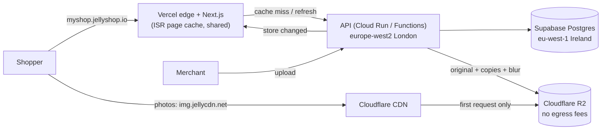

# Speed and cost, Phase 3: hosting, image CDN and domains (plan)

> **Owner decisions, 2026-11-23: this plan is parked in part.** The API **stays in Iowa** (`us-central1`) and the
> storefront **stays on Vercel's free Hobby plan**; neither London/Dublin nor Vercel Pro is being done for now. The
> code defaults match (Iowa, 5 instances, no `vercel.json`). R2 photos (staging) and the cached-page work are kept.
> Where this document recommends Vercel Pro, London or Dublin, read it as "later, when real shops trade"; the steps
> are in `docs/launch/hosting-move-checklist.md`. Hobby limits to watch (check Vercel's pricing page for the current
> numbers): monthly data transfer, function invocations, CPU time and ISR reads/writes. Vercel's terms limit Hobby
> to personal, non-commercial use, so this holds while the platform is in testing.

Status: **plan, waiting for your decisions.** Nothing has been changed. Part of
`docs/plans/2026-11-20-speed-and-cost-plan.md`. Prices and product facts were checked on 2026-11-22 (sources at
the end); confirm them on the live pricing pages before signing up.

## What changed since the first plan

The first plan recommended running Next.js on Cloudflare Workers after a short trial. I checked again and **no longer
recommend that for now**:

- Cloudflare's own guide now steers new Next.js apps to a different, newer adapter ("vinext") and keeps OpenNext for
  existing apps.
- OpenNext's Cloudflare adapter does not yet recognise Next 16's `proxy.ts` (our password check lives there since
  Phase 1, and the subdomain plan routes every shop through it), and Next 16 support isn't stated.
- Next 16.2 added an official adapter API that Cloudflare, Netlify and AWS adapters are being built on, expected
  "later this year". That is the moment to look again.

Also, the subdomain plan written in another session today (`docs/plans/2026-11-22-subdomain-tenancy-plan.md`)
assumes **Vercel** and asks for uploads on a **separate domain** for security. This plan fits both.

## Recommendation in one line

**Run the storefront and admin on Vercel Pro now; move photos to Cloudflare R2 on their own domain behind
Cloudflare's CDN; put the API next to the database in Europe.** Revisit Cloudflare for the Next.js part once its
Next 16 adapter is out.

## 3a. Photos on Cloudflare R2 (do first, works with any host)

Today every photo a shopper sees passes through the API function and Supabase Storage. After this step photos go
straight from Cloudflare's CDN; the API only handles uploads.

| Piece | Plan |
| --- | --- |
| Bucket | One R2 bucket (e.g. `jellyshop-media`), Standard storage. Keys stay exactly as today: `<storeId>/<mediaId>.<ext>` and copies `<…>.w640.webp`. |
| Public address | A separate domain you own, e.g. `img.jellycdn.net` (the subdomain plan's security rule: uploads never on `*.jellyshop.io`), connected to the bucket as its public custom domain. |
| Caching | Every object is written with `Cache-Control: public, max-age=31536000, immutable` and a fixed `Content-Type` from our allow-list (`image/webp`, `jpeg`, `png`, `gif`, `avif`; never SVG/HTML); a Cloudflare rule caches everything on that domain. Files never change (new photo = new id), so nothing ever needs purging. |
| Headers on that domain | `X-Content-Type-Options: nosniff`, `Content-Security-Policy: default-src 'none'`, no cookies. |
| Backend | New `R2MediaStorage` (put/open/remove over R2's S3 API) chosen by `MEDIA_PROVIDER=r2`, plus `MEDIA_PUBLIC_BASE=https://img.jellycdn.net`. Upload responses and catalogue media then carry the direct photo address. |
| Storefront | Card and gallery `srcset` build copy addresses from the direct address (`…/<id>.png.w640.webp`) using the `variantWidths` recorded in Phase 2, so shoppers never touch the API for a photo. |
| Old addresses | `/api/public/media/<store>/<id>?w=…` keeps working and answers with a permanent redirect (301) to the photo's CDN address. Browsers and Vercel's cache keep the redirect, so old links stored in published designs cost almost nothing. A later step can rewrite those links at Publish. |
| Moving existing files | Script `backend/scripts/copy-media-to-r2.ts` (`--dry-run` first): copies every original and copy from Supabase Storage to R2, checks size and hash, writes nothing to the database. During the move `R2MediaStorage.open` falls back to Supabase for anything not copied yet. Supabase files are deleted only later, after you approve it separately. Staging today: 344 files, 81 MB. |

Cost per store after the move (unchanged from the first plan): small < $0.01, medium ~$0.02, large ~$0.22 a month
(R2: $0.015/GB-month, $0.36 per million reads, egress free; first 10 GB and 10 million reads a month free).

## 3b. Where Next.js runs

| Option | Fit today | Cost shape | Main risk |
| --- | --- | --- | --- |
| **A. Vercel Pro (recommended now)** | Made by the Next.js team: Next 16, `proxy.ts`, ISR and `revalidateTag` work as designed; the page cache is shared by all servers, so a refresh reaches everyone; wildcard subdomains and custom domains are built in (the subdomain plan's setup) | $20 per seat (with $20 of usage credit). Then ISR reads $0.40/million (1M included), ISR writes $4/million (200k included), data transfer 1 TB included then from $0.15/GB, CPU from $0.128/hour (4 h included); prices vary by region | Data transfer grows with traffic. Mitigation: keep page weight down (next item below) and a budget alert |
| B. Cloud Run (next to the API) behind Cloudflare's CDN | Works with any Next feature; Cloudflare caches HTML and assets for free bandwidth | A few dollars of compute; no transfer bill from Cloudflare | We would have to build a shared page cache (each server keeps its own ISR copy otherwise, so a refresh only reaches one server) and purge Cloudflare's copy on every store change. Real engineering and something to run |
| C. Cloudflare Workers | Cheapest at scale | $5 base + small usage | Adapter not ready for Next 16 / `proxy.ts` today (see above) |

Estimated Vercel transfer per store, with photos on R2 (compressed pages ~40–60 KB, scripts cached after the first
visit, ~100 KB per view on average):

| Store | Page views / month | Transfer | Cost beyond the included 1 TB |
| --- | --- | --- | --- |
| Small | 2,000 | ~0.2 GB | $0.03 |
| Medium | 20,000 | ~2 GB | $0.30 |
| Large | 200,000 | ~20 GB | $3.00 |

The included 1 TB covers roughly 500 medium stores before any of that is paid. A large store at $3 extra would drop
from ~82% to ~67% margin on $20, under the target, so two things go with option A:

1. **Trim page weight** (the item left over from Phase 1): pages still carry the whole catalogue, 190–300 KB before
   compression. Sending only what each page shows would roughly halve transfer and speed up phones.
2. **Fair use** in Phase 4: above ~250k page views a month a store moves to a higher plan.

When the platform passes ~1 TB a month, or Cloudflare's Next 16 adapter ships, compare B/C again with real numbers
from Vercel's usage page.

## 3c. API next to the database

The API runs in `us-central1` (Iowa) and the database in `eu-west-1` (Ireland), so every uncached request crosses
the Atlantic several times (~80–100 ms per round trip). Move the API function to **`europe-west2` (London)** and
pin Vercel functions to **`dub1` (Dublin)**. Uncached page builds and every checkout/admin request get much faster.
The function's address changes, so the storefront's `NEXT_PUBLIC_STORE_EDITOR_API_URL` / `STOREFRONT_API_URL` and
the Stripe webhook address must be updated in the same deploy. Also raise `maxInstances` from 5 (with a budget
alert) now that most traffic no longer reaches it.

## 3d. Shop addresses and custom domains

- `<slug>.jellyshop.io` and the shop routing: exactly as in the subdomain plan (Vercel wildcard domain, `proxy.ts`).
  The Phase 1 password check is already in that proxy file; the two must live together in it.
- Own domains (`www.myshop.co.uk`): on Vercel, add each one through Vercel's domains API (certificate issued and
  renewed by Vercel; Pro has no practical domain limit). The `StoreDomain` table records the domain, its
  verification state and the store; `proxy.ts` looks the host up (cached). Cloudflare for SaaS ($0.10 per hostname a
  month after the first 100) is the alternative if we ever move off Vercel.
- Photos stay on `img.jellycdn.net` for every shop and every custom domain.

## Order of work

| Step | What | Needs from you |
| --- | --- | --- |
| 1 | Code: `R2MediaStorage`, `MEDIA_PUBLIC_BASE`, direct photo addresses in upload/catalogue responses, storefront `srcset` from them, 301 from the old route, copy script with dry run; tests against a fake S3 server | OK on one small new backend library for signing R2 requests (`aws4fetch`, ~2 KB, no dependencies) instead of the large AWS SDK |
| 2 | Accounts: Cloudflare account, the photo domain, R2 bucket and an R2 API token (put into the backend's environment by you; I never see or type keys) | You create them; I give click-by-click steps |
| 3 | Staging: copy dry run, then copy, then switch staging to `MEDIA_PROVIDER=r2`; check photos load from the CDN, uploads land in R2, old links redirect | Your yes before the copy and before the switch |
| 4 | Vercel project + `dub1`, API to `europe-west2`, env vars, Stripe webhook address | Vercel account/token (the old one is invalid), your yes to deploy |
| 5 | Measure: Lighthouse, time to first byte, Vercel usage after a week | — |
| 6 | Later, separately approved: delete the Supabase copies of photos | Your yes |

The subdomain work can run in parallel after step 4; step 1 doesn't touch the same files.

## Decisions for you

1. **Hosting:** Vercel Pro now (recommended), or Cloud Run + Cloudflare (more work, cheaper at large scale)?
2. **Photo domain:** a separate domain you'd buy (e.g. `jellycdn.net` or `jellyshopusercontent.com`)?
3. **Library:** `aws4fetch` for R2 signing (recommended) or the AWS SDK?
4. **API region:** move to London (`europe-west2`) together with the Vercel setup?
5. **Start with step 1** (code only, no accounts needed yet)?

## Sources

- Cloudflare: [Next.js on Workers (OpenNext / vinext guidance)](https://developers.cloudflare.com/workers/framework-guides/web-apps/opennext/), [OpenNext Cloudflare](https://opennext.js.org/cloudflare), [OpenNext Cloudflare releases](https://github.com/opennextjs/opennextjs-cloudflare/releases), [Next.js across platforms (adapter API)](https://nextjs.org/nextjs-across-platforms)
- Vercel: [Pricing](https://vercel.com/pricing), [Pricing docs](https://vercel.com/docs/pricing), [Regional pricing (sfo1 example)](https://vercel.com/docs/pricing/regional-pricing/sfo1)
- Cloudflare R2 and SaaS: [R2 pricing](https://developers.cloudflare.com/r2/pricing), [Cloudflare for SaaS plans](https://developers.cloudflare.com/cloudflare-for-platforms/cloudflare-for-saas/plans/)

## Step 1 built (2026-11-22, code only, nothing switched on)

| Piece | Where |
| --- | --- |
| R2 storage (signed with `aws4fetch` 1.0.20; immutable, image-only types; refuses keys that leave the store folder; reads fall back to Supabase while files move; removes from both) | `backend/src/media/r2-media-storage.ts` |
| Settings `MEDIA_PROVIDER=r2`, `R2_ACCOUNT_ID`, `R2_ACCESS_KEY_ID`, `R2_SECRET_ACCESS_KEY`, `R2_BUCKET`, `MEDIA_PUBLIC_BASE` (https only); the backend refuses to start with `r2` and missing R2 settings | `backend/src/config.ts`, `app/dependencies.ts`, `.env.example` |
| Direct photo addresses: upload/list responses and catalogue product media carry `publicUrl` when `MEDIA_PUBLIC_BASE` is set (not for outside links); the old `/api/public/media/...` address answers 301 to the right copy (the next larger recorded width, else the largest, else the original) without reading the file | `backend/src/media/public-url.ts`, `service.ts` (`publicLocation`), `routes.ts`, `catalog/postgres-repository.ts` |
| Storefront: product photos use `publicUrl`; cards and the product gallery build `srcset` from the recorded widths as `<url>.w<width>.webp`, each described by its real width | `storefront-schema` `directPhotoSrcSet` (+ `productMediaSrcSet`), `storefront-ui` `cardPhotoSrcSet`, `commerce/api/client.ts` |
| Copy script (lists every file in the Supabase bucket, skips files already in R2 with the same size, checks the size after each copy, never changes the source or the database) | `backend/scripts/copy-media-to-r2.ts`, logic `src/media/copy-to-r2.ts`, listing `SupabaseMediaStorage.listFiles()` |

Checked: backend 835/835 tests (R2 storage against a pretend bucket incl. the AWS signature header, fallback,
type and key rules; public addresses and the 301 for each width; copy dry run / copy / rerun / size mismatch /
unreadable file); storefront tests for direct sizes and the product mapping; the new listing against staging storage
(read-only): 344 files, 81.2 MB, all with sizes, in 5 top folders. The schema package was repacked for the backend.

Not checked: a real R2 bucket (no account yet). Images chosen in the editor (section images) keep their API address
and are served through the 301 until a later step rewrites them at Publish.

Order to switch on (staging), each with your yes: create the account/bucket/token → set `MEDIA_PROVIDER=r2` + R2
settings (new uploads go to R2, old files still read from Supabase) → copy dry run → copy → set `MEDIA_PUBLIC_BASE`.
